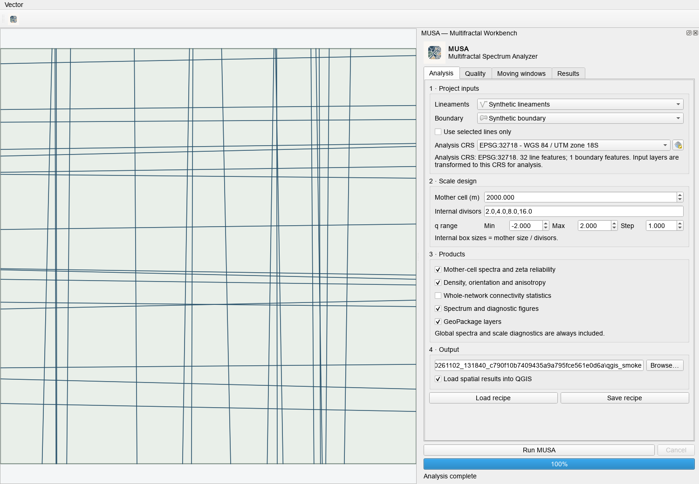

<a href="README.md">English</a> · <strong>Español</strong>

# MUSA — Multifractal Spectrum Analyzer

**Análisis fractal y multifractal de datos espaciales y lineamientos, con productos GIS.**

Combina estimación directa Chhabra–Jensen, análisis local por celdas madre,
ponderación multiescala zeta, estadística estructural y exportación reproducible.
Permite examinar complejidad multifractal separadamente de densidad estructural
y confiabilidad numérica.

## Instalación en QGIS

QGIS es la interfaz principal de MUSA. El plugin local 1.0.0 es experimental
y todavía no está publicado; la release pública anterior sigue siendo 1.0.1.
El panel está en inglés y sigue el flujo acoplable de GeoMorphX y TerraWorkbench.

Incluye una [evaluación experimental de soporte de escalamiento de Rényi](docs/SCALING_SUPPORT.md):
compara ajustes log–log, estabilidad entre escalas y orígenes de malla, y un
modelo nulo opcional de traslación de trazas. Se activa en Quality, en recetas
o mediante Processing > Assess Renyi scaling support. Conserva los q que
fallan y separa evidencia compatible, contraria e insuficiente en el intervalo
observado. No certifica fractalidad ni constituye un análisis espacial 3D.

En Results puedes elegir centro y tamaño de ventana para consultar Dq, τ(q),
α(q) y f(α), y exportar la figura a PNG/SVG. Se distinguen α(q=0), el máximo
observado y el pico ajustado, con sus estados de calidad. Consulta
[espectros por ventana](docs/SPECTRA.md).

Genera el paquete desde el repositorio:

    python scripts/build_qgis_plugin.py

En este workspace Windows usa DEVRESOURCES_RUN.cmd antes del comando.
En QGIS abre Complementos > Administrar e instalar complementos > Instalar
a partir de ZIP y selecciona el paquete de dist/qgis. Abre después
Vector > MUSA > MUSA Workbench.

La [guía de QGIS en inglés](docs/QGIS.md) explica dependencias, recetas,
Processing y límites. El núcleo se comparte con la API Python; no se instala
automáticamente ninguna dependencia dentro de QGIS. Los lanzadores anteriores
se conservan como código legado y no se incluyen en el plugin.

Para la API desde fuente, con Python 3.10 o superior:

    python -m pip install -e .[gis]

## Flujo recomendado

1. Selecciona capas de lineamientos y límite en QGIS y elige un CRS de análisis proyectado en metros.
2. Define tamaño de celda madre y suficientes resoluciones internas.
3. Ejecuta el análisis global y revisa el intervalo de q aceptado.
4. Exporta celdas locales con zeta y las marcas reliable.
5. Compara densidad, orientación, alpha, alpha_w y confiabilidad.
6. Revisa sensibilidad de zeta y controles sintéticos antes de interpretar.

Los espectros globales y locales incluyen Dq, tau, alpha, f(alpha), calidad de
ajuste y diagnósticos de escala. Hay estimaciones locales D0/D1, alternativas
Theil–Sen, bootstrap, jackknife, apalancamiento y diagnóstico de Cook.
Los productos estructurales incluyen longitud, orientación, anisotropía y
conectividad. Se exportan CSV, PNG, GeoPackage y paquetes ZIP.

## Ejemplo Python

~~~python
import numpy as np
from musa import MUSA

rng = np.random.default_rng(42)
points = rng.random((5000, 2))
analyzer = MUSA(points, q_values=np.linspace(-4, 4, 9))
result = analyzer.run_analysis(min_scale=0.01, max_scale=0.4, num_scales=24)
print(result.q)
print(result.dq)
print(result.alpha)
~~~

Los [ejemplos](examples) amplían los flujos espaciales, GIS, sintéticos y estructurales.

## Ventanas móviles y desarrollo

Las ventanas multiescala superpuestas son experimentales. Exportan espectros y
uniones planares únicas con diagnósticos de cobertura y dominancia de q alto;
describen concentración estructural, no permeabilidad.

El perfil de desarrollo admite 16 orígenes y siete escalas internas y mantiene
separados rangos descriptivos y clases sustentadas. Usa métodos genéricos y
controles sintéticos. El panel QGIS ofrece los 16 orígenes como opción explícita;
por defecto usa un origen y cuatro escalas internas para exploración. Los datos, reglas y entregas privadas no son ejemplos del
software. La aceleración opcional conserva una alternativa Python:

~~~powershell
pip install -e ".[gis,fast]"
~~~

- [Ventanas móviles y límites](docs/moving_windows.md).
- [Puntuación de candidatos](docs/candidate_scoring.md).
- [Teoría](docs/theory.md) y [referencias científicas](docs/references.md).

## Estado y límites

La release pública es 1.0.1; el plugin QGIS experimental pasa a 1.0.0 por petición
del mantenedor. Se conservan los tags históricos. La conversión QGIS ya está
subida como código, pero aún no se ha publicado una nueva release del plugin.
Consulta el [alcance de la validación matemática](docs/SCALING_VALIDATION_STATUS.md):
los filtros actuales no demuestran por sí solos fractalidad ni multifractalidad.
Consulta el [estado de desarrollo](docs/DEVELOPMENT_STATUS.md) para las verificaciones ejecutadas.
La [validación ampliada con datos publicados](docs/EXTENDED_BENCHMARKS.md)
incluye Åland, Loviisa, Bristol, ejemplos de HatchFrac/FracPaQ, derivados de
Hornelen y una selección FraXet, con procedencia, controles analíticos y límites
de interpretación explícitos. Los originales y resultados se conservan fuera del plugin.
Las pruebas cubren espectros, zeta, modos de
interfaz, empaquetado GIS y casos sintéticos. La contribución es integrar estos
métodos y sus diagnósticos, no inventar el análisis multifractal de lineamientos.
Zeta es un peso operativo de confiabilidad, no una propiedad física medida.
Un ajuste estable o zeta alto no demuestra un proceso geológico; cada conjunto
requiere validación externa apropiada.

El paquete está en src/musa, los ejemplos en examples y las pruebas en tests.
Los resultados generados y experimentos locales se excluyen del control de versiones.

## Licencia y contacto

[GNU GPL v3](LICENSE), con fuente de las releases disponible en el repositorio.
Jordan Zavaleta — [correo](mailto:jordanzav@gisgeo.dev) · [GisGeo Dev](https://gisgeo.dev).
