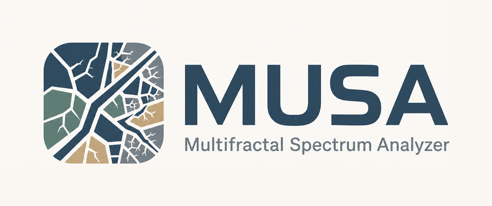
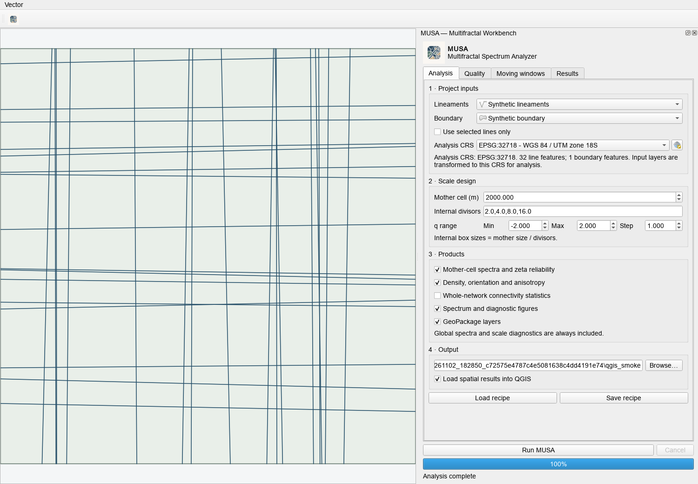

<strong>English</strong> · <a href="README.es.md">Español</a>

  

  Fractal and multifractal analysis for spatial data, geological lineaments, and GIS-ready interpretation.

  
  
  
  
  
  

  <a href="docs/QGIS.md"><strong>Install MUSA for QGIS</strong></a>
  ·
  <a href="docs/theory.md">Method reference</a>
  ·
  <a href="docs/references.md">Scientific references</a>

## Overview

MUSA provides a Python numerical engine and a QGIS workbench for direct Chhabra–Jensen estimation, local mother-cell analysis, multiscale reliability weighting, structural statistics, and reproducible GIS export. The engine can run without QGIS. The plugin bundles a private snapshot of the same core; installing the Python package does not install or update the QGIS plugin.

| Start here | Guide |
| --- | --- |
| Follow the illustrated QGIS workflow | [Spanish user guide](docs/USER_GUIDE.es.md) |
| Install and check distribution availability | [Installation](docs/INSTALLATION.md) |
| Understand engine, QGIS adapter and recipes | [Architecture](docs/ARCHITECTURE.md) |
| Run without QGIS | [Python API](docs/PYTHON_API.md) |
| Read formulas and result fields | [Theory](docs/theory.md) and [outputs](docs/OUTPUTS.md) |
| Browse all documentation | [Documentation index](docs/README.md) |

Installation with pip from GitHub is available. PyPI publication and a general
installed recipe-running CLI remain pending. The existing musa-ui entry point
opens the legacy Tk interface; it is not the QGIS workbench or a headless runner.

MUSA 1.1.0 is the first QGIS plugin release. Download musa_qgis-1.1.0.zip from the
[latest release](https://github.com/jordan-zav/MUSA/releases/latest) and install it with
Plugins > Manage and Install Plugins > Install from ZIP.

It is designed for spatial point data and geological lineaments where multifractal complexity must be interpreted separately from structural density and model reliability.

## Highlights

The [indexed spectrum viewer](docs/SPECTRA.md) provides Dq, tau(q), alpha(q)
and f(alpha) for the global domain and each moving window. Select a center,
size and estimator; export the selected figure to PNG/SVG. Alpha at q=0,
observed maximum and descriptive fitted peak remain separate.

Experimental [Rényi scaling-support assessment](docs/SCALING_SUPPORT.md) compares
fixed-interval log–log models, scale/grid stability and an optional conditional
trace-relocation null. It retains every q and distinguishes compatible,
unsupported and insufficient finite-range evidence. Available in Workbench
Quality, recipes and the independent Processing tool musa:scaling_support.
It does not certify fractality or infer 3D geometry.

Experimental overlapping multiscale windows are available in the QGIS workbench
and Python API. They export local spectra and unique planar
fracture junctions with coverage and high-q dominance diagnostics. See
[moving-window usage and limitations](docs/moving_windows.md). These outputs
describe structural concentration; they do not estimate permeability.

| Analysis | Reliability | GIS and outputs |
| --- | --- | --- |
| Global and local multifractal spectra | Multiscale zeta weighting | GeoPackage mother-cell export |
| Generalized dimensions Dq and tau | Reliable flags by mother cell and q | Structural density and orientation maps |
| Local D0 and D1 estimates | Bootstrap and jackknife sensitivity | Exact lineament connectivity statistics |
| Robust Theil–Sen alternatives | Leverage and Cook diagnostics | CSV, PNG and GeoPackage products |
| Controlled synthetic validation | Optional negative-q floor (alters the measure; see [negative q](docs/NEGATIVE_Q.md)) | QGIS workbench, Processing and Python |

## Install in QGIS

Build the plugin from this checkout:

    python scripts/build_qgis_plugin.py

In QGIS, open Plugins > Manage and Install Plugins > Install from ZIP and select
the ZIP generated in dist/qgis. Then open Vector > MUSA > MUSA Workbench.
See the [QGIS guide](docs/QGIS.md) for dependencies, recipes, Processing and limits.
The plugin uses the Python packages supplied by your QGIS installation and does
not install or replace interpreter dependencies.

The former Tk desktop interface remains in the source (musa-ui) as legacy code;
it is no longer distributed as an executable. QGIS is the primary interface.

## Python API installation

Requirements: Python 3.10 or newer.

    git clone https://github.com/jordan-zav/MUSA.git
    cd MUSA
    python -m venv .venv
    .venv\Scripts\Activate.ps1
    python -m pip install --upgrade pip
    python -m pip install -e .

Install the optional GIS stack with:

    python -m pip install -e ".[gis]"

Use a new output directory to run the complete synthetic workflow without QGIS:

    python examples/headless_workflow.py --output outputs/headless_demo

See the installation guide for activation on Linux/macOS and direct installation
from Git without cloning. The example uses synthetic, unlocated model coordinates.

Run the development commands from the repository root.

## Quick Python example

    import numpy as np
    from musa import MUSA

    rng = np.random.default_rng(42)
    points = rng.random((5000, 2))

    analyzer = MUSA(
        points,
        q_values=np.linspace(-4, 4, 9),
    )
    result = analyzer.run_analysis(
        min_scale=0.01,
        max_scale=0.4,
        num_scales=24,
    )

    print(result.q)
    print(result.dq)
    print(result.alpha)

More complete spatial, GIS, synthetic, and structural examples are available in the [examples](examples) directory.

## Recommended GIS workflow

1. Select QGIS lineament and boundary layers and an explicit projected analysis CRS in metres.
2. Select a mother-cell size and enough child resolutions for stable regression.
3. Run the global analysis and inspect the accepted q range.
4. Export local mother cells with zeta and reliable values.
5. Compare density, orientation, alpha, alpha_w, and reliability.
6. Use synthetic validation and zeta sensitivity before drawing strong geological conclusions.

## Main products

| Product | Purpose |
| --- | --- |
| Global spectrum tables | Dq, tau, alpha, f alpha, fit quality, and scale diagnostics |
| Mother-cell tables | Local monofractal and multifractal estimates |
| Reliability products | zeta summaries, reliable flags, bootstrap intervals, and sensitivity profiles |
| Structural products | Density, total length, dominant azimuth, anisotropy, and connectivity |
| GIS package | GeoPackage layers for mapping and downstream analysis |
| Run package | Organized ZIP archive containing selected outputs |

## Moving-window development profile

This development profile is documented with generic methods and synthetic
controls. Private project datasets, deliverables, geological rules and production
metrics are maintained separately and are not distributed as MUSA examples.

The development API supports 16 grid origins over seven internal scales and
checks both candidate and background origin banks. The QGIS panel exposes grid
origin averaging as an explicit option; its default is a single origin and four
internal scales to keep exploratory runs manageable. Descriptive
ranks remain separate from supported classes. See [candidate scoring](docs/candidate_scoring.md)
for v7 configuration, diagnostics, residual boundary bias and map-resolution limits.
Optional acceleration: <code>pip install -e ".[gis,fast]"</code>; the Python fallback uses the
same conservative partition. This development profile is not geological validation.

## Methodological scope

MUSA does not claim to introduce multifractal analysis of lineaments. Its contribution is the integration of direct global and local Chhabra–Jensen analysis, probability recalculation within each mother cell, multiscale zeta weighting, explicit reliability diagnostics, and GIS-ready export.

Zeta is an operational reliability weight. It should not be interpreted as a direct physical property.

## Repository map

| Path | Contents |
| --- | --- |
| src/musa | Shared numerical core, workflow API, plotting, GIS export and validation |
| qgis_plugin | QGIS dock, Processing, native input and output adapters |
| scripts/build_qgis_plugin.py | Installable plugin ZIP with private bundled core |
| examples | Reproducible Python workflows |
| tests | Automated algorithm and interface tests |
| docs/theory.md | Detailed methodological reference |
| docs/references.md | Scientific literature supporting the approach |

Generated datasets, local experiments, and temporary outputs are intentionally excluded from version control.

## Project status

MUSA 1.1.0 is the current public release and the first QGIS plugin release.
See the [mathematical validation scope](docs/SCALING_VALIDATION_STATUS.md) for what the
current scaling diagnostics can establish.
The [extended public-data benchmarks](docs/EXTENDED_BENCHMARKS.md) add original
vectors, author model examples and identified image derivatives, with explicit
provenance, mathematical controls and interpretation limits. Data and generated
results remain outside the plugin package.
Automated tests cover the global and
local spectra, zeta formula, interface modes, GIS packaging, structural metrics
and synthetic cases. External geological validation remains dataset-specific:
a stable numerical fit or high zeta weight is not proof of a geological process.

## How to cite

If you use MUSA, please cite the version you used:

> Zavaleta, J. (2026). *MUSA: Multifractal Spectrum Analyzer* (version 1.1.0) [Software]. Zenodo. https://doi.org/10.5281/zenodo.24099091

The concept DOI [10.5281/zenodo.24099090](https://doi.org/10.5281/zenodo.24099090) always points to the latest version. GitHub's "Cite this repository" button uses [CITATION.cff](CITATION.cff).

## License

MUSA is distributed under the [GNU General Public License v3.0](LICENSE). The
source code required to build and modify each release is available in this
repository.

Jordan Zavaleta — GisGeo Dev 
[jordanzav@gisgeo.dev](mailto:jordanzav@gisgeo.dev) · [gisgeo.dev](https://gisgeo.dev)
