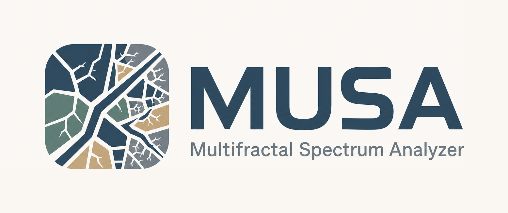

  

  Fractal and multifractal analysis for spatial data, geological lineaments, and GIS-ready interpretation.

  
  
  
  
  

  <a href="https://github.com/jordan-zav/MUSA/releases/download/v1.0.1/MUSA-1.0.1-Windows-x64.exe"><strong>Download MUSA for Windows</strong></a>
  ·
  <a href="docs/theory.md">Method reference</a>
  ·
  <a href="docs/references.md">Scientific references</a>

## Overview

MUSA combines direct Chhabra–Jensen estimation, local mother-cell analysis, multiscale reliability weighting, structural statistics, and reproducible GIS export in one Python framework and desktop application.

It is designed for spatial point data and geological lineaments where multifractal complexity must be interpreted separately from structural density and model reliability.

## Highlights

| Analysis | Reliability | GIS and outputs |
| --- | --- | --- |
| Global and local multifractal spectra | Multiscale zeta weighting | GeoPackage mother-cell export |
| Generalized dimensions Dq and tau | Reliable flags by mother cell and q | Structural density and orientation maps |
| Local D0 and D1 estimates | Bootstrap and jackknife sensitivity | Exact lineament connectivity statistics |
| Robust Theil–Sen alternatives | Leverage and Cook diagnostics | CSV, PNG, GeoPackage, and ZIP products |
| Controlled synthetic validation | Negative-q stabilization | Desktop and Python workflows |

## Download

The standalone Windows build does not require a separate Python installation.

  

| Release | Platform | File | SHA-256 |
| --- | --- | --- | --- |
| v1.0.1 | Windows x64 | MUSA-1.0.1-Windows-x64.exe | `d10181fd2f34c663dc0b05398f8ab48dfc10cded0fe19b710bb4db8602cfb158` |

See the [latest release](https://github.com/jordan-zav/MUSA/releases/latest) for release notes and assets.

## Install from source

Requirements: Python 3.10 or newer.

    python -m venv .venv
    .venv\Scripts\Activate.ps1
    python -m pip install --upgrade pip
    python -m pip install -e .
    musa-ui

Install the optional GIS stack with:

    python -m pip install -e .[gis]

The included launch_musa_ui.bat file can also start the desktop interface from a local checkout.

## Quick Python example

    import numpy as np
    from musa import MUSA

    rng = np.random.default_rng(42)
    points = rng.random((5000, 2))

    analyzer = MUSA(
        points,
        q_values=np.linspace(-4, 4, 9),
    )
    result = analyzer.run_analysis(
        min_scale=0.01,
        max_scale=0.4,
        num_scales=24,
    )

    print(result.q)
    print(result.dq)
    print(result.alpha)

More complete spatial, GIS, synthetic, and structural examples are available in the [examples](examples) directory.

## Recommended GIS workflow

1. Prepare lineaments and an analysis boundary in a metric CRS, or enable automatic reprojection.
2. Select a mother-cell size and enough child resolutions for stable regression.
3. Run the global analysis and inspect the accepted q range.
4. Export local mother cells with zeta and reliable values.
5. Compare density, orientation, alpha, alpha_w, and reliability.
6. Use synthetic validation and zeta sensitivity before drawing strong geological conclusions.

## Main products

| Product | Purpose |
| --- | --- |
| Global spectrum tables | Dq, tau, alpha, f alpha, fit quality, and scale diagnostics |
| Mother-cell tables | Local monofractal and multifractal estimates |
| Reliability products | zeta summaries, reliable flags, bootstrap intervals, and sensitivity profiles |
| Structural products | Density, total length, dominant azimuth, anisotropy, and connectivity |
| GIS package | GeoPackage layers for mapping and downstream analysis |
| Run package | Organized ZIP archive containing selected outputs |

## Methodological scope

MUSA does not claim to introduce multifractal analysis of lineaments. Its contribution is the integration of direct global and local Chhabra–Jensen analysis, probability recalculation within each mother cell, multiscale zeta weighting, explicit reliability diagnostics, and GIS-ready export.

Zeta is an operational reliability weight. It should not be interpreted as a direct physical property.

## Repository map

| Path | Contents |
| --- | --- |
| src/musa | Core package, desktop interface, plotting, GIS export, and validation |
| examples | Reproducible Python workflows |
| tests | Automated algorithm and interface tests |
| docs/theory.md | Detailed methodological reference |
| docs/references.md | Scientific literature supporting the approach |

Generated datasets, local experiments, and temporary outputs are intentionally excluded from version control.

## License

MUSA is distributed under the [GNU General Public License v3.0](LICENSE). The source code required to build and modify each release is available in this repository.
