# Fundamentos: cómo se organiza una red de fracturas

## 1. Cómo se analiza la estructuralidad

Durante mucho tiempo, el análisis de la estructuralidad en geología se ha reducido con frecuencia a un mapa de densidad, a la distancia euclidiana a las estructuras o a una estimación de dimensión fractal hecha con un único ajuste. Cada uno de esos resúmenes responde a una pregunta distinta: dónde hay más trazas, a qué distancia queda la más cercana, qué orientaciones dominan o cuánto espacio ocupa la red. Este capítulo los recorre uno por uno sobre el mismo mapa, muestra qué conserva cada uno y qué deja fuera, y llega así a la pregunta que interesa a MUSA: cómo cambia la organización de la red al cambiar la escala de observación.

El recorrido empieza por el objeto geológico, sigue con los enfoques habituales y construye después las ideas de fractalidad, conteo de cajas y multifractalidad, que proceden de una literatura amplia. Las últimas secciones explican qué hace MUSA con esas herramientas y cómo leer sus resultados. Todos los ejemplos son sintéticos y se expresan en metros de modelo, sin ubicación geográfica; sirven para mostrar cómo funciona cada medida, no para interpretar un terreno concreto.

## 2. La base geológica: del afloramiento al mapa

Una fractura es una discontinuidad de la roca, y su intersección con una superficie de observación deja una traza. Un mapa de trazas registra esas intersecciones, o su interpretación, sobre un afloramiento, una imagen o un modelo de relieve. Un lineamiento es una expresión lineal reconocible en una imagen, en la topografía o en un campo geofísico; puede corresponder a una falla, a un sistema de diaclasas, a un contacto litológico o a una alineación geomorfológica, y su naturaleza se establece contrastando fuentes y observaciones de campo. Sander (2007) revisa esta diversidad de usos y los límites de interpretar lineamientos como fracturas conductoras.

En afloramiento se miden orientación, longitud visible, apertura, relleno y relaciones de corte. Las fotografías aéreas, las imágenes satelitales y los modelos de relieve amplían la cobertura y permiten seguir familias de trazas, aunque la vegetación, la iluminación y la resolución condicionan lo que se reconoce. La geofísica ayuda a interpretar estructuras bajo cobertura, con su propia resolución y ambigüedad. El mapa final arrastra las decisiones de detección, generalización y conexión de cada fuente, y conviene tenerlas presentes al medirlo.

Las fracturas abren caminos para la circulación de fluidos o actúan como barreras cuando están selladas. Su conectividad, apertura y relleno condicionan la permeabilidad, la circulación hidrotermal puede asociarse a mineralización, y la orientación y persistencia de las discontinuidades intervienen en la estabilidad de bloques y taludes. Berkowitz (2002) revisa el vínculo entre redes de fracturas y transporte, y Bonnet y colaboradores (2001) reúnen las leyes de escala observadas en sistemas de fracturas, desde la lámina delgada hasta la escala regional. La geometría es una parte del problema: dos redes con la misma longitud total pueden conectarse de forma muy distinta (Sanderson y Nixon, 2015), y una concentración geométrica necesita contexto geológico para asociarse con una propiedad física.

De ahí el interés por saber si las concentraciones de trazas persisten desde el afloramiento hasta el distrito o si aparece una separación característica entre corredores. Para comparar las respuestas de cada enfoque, la Figura 1 fija un mapa común: 627 trazas de tres familias, centradas en 20°, 80° y 140° respecto al eje x y con dispersión, dentro de un polígono de observación irregular. El polígono gris marca dónde se observó; fuera de él no hay inventario.

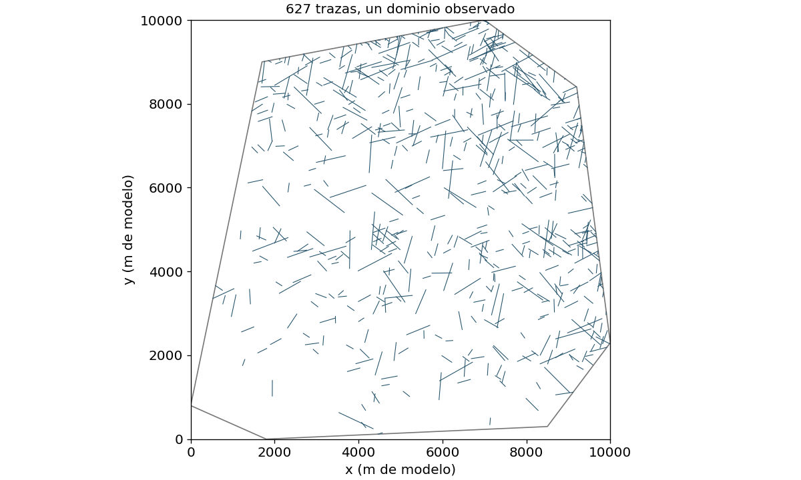

Figura 1. Red de referencia con 627 trazas. Las zonas densas y los sectores casi vacíos pertenecen al mismo inventario, y todas las comparaciones siguientes usan esta red y este dominio.

## 3. Qué responden los enfoques habituales

### Densidad de longitud

La forma más directa de reconocer corredores fracturados es sumar la longitud de trazas dentro de un círculo de radio r y dividirla por el área observada de ese círculo:

::math ρr(x) = Σ longitud(traza ∩ círculo ∩ dominio) / área(círculo ∩ dominio)

El resultado se expresa en m/m2 y equivale a la intensidad P21 de la literatura de fracturas; Mauldon y colaboradores (2001) derivan estimadores de esta magnitud con ventanas circulares. Al usar longitud, una traza larga pesa más que una corta. Programas como LINDENS (Casas y colaboradores, 2000) o FracPaQ (Healy y colaboradores, 2017) generan estos mapas de forma rutinaria, y en ambos el tamaño de celda o de ventana es una elección del usuario.

La Figura 2 aplica un radio de 1000 m sobre una grilla de 100 m. En el borde, el denominador es solo la parte del círculo que cae dentro del polígono, de modo que la estimación se refiere siempre a la superficie observada. El mapa muestra bien dónde se acumula longitud a ese radio. Un radio mayor suaviza los contrastes y uno menor destaca grupos locales; cada elección describe una sola escala de vecindad, y para ver cómo cambia la organización hay que repetir el cálculo con varios radios y compararlos.

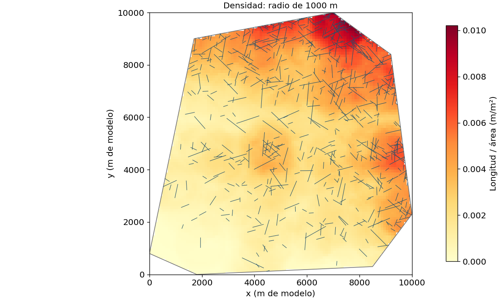

Figura 2. Longitud por unidad de área con radio de 1000 m. Los tonos rojos señalan los corredores que concentran longitud a ese radio; fuera del polígono no hay estimación.

### Distancia euclidiana a estructuras

En los modelos de prospectividad es habitual transformar las estructuras en un mapa de proximidad, con la idea de que la cercanía a un corredor de fluidos favorece la mineralización. La distancia a la traza más cercana se define como

::math d(x) = min { distancia(x, y) : y pertenece a las trazas }

Nykänen y colaboradores (2008) ilustran este uso en un modelo de prospectividad para depósitos IOCG; la pertinencia geológica de cada estructura se decide antes de convertir su distancia en evidencia. La Figura 3 calcula d(x) en la misma grilla de 100 m.

El mapa responde a cuánto hay que desplazarse para alcanzar una estructura cartografiada, y nada más. Un punto junto a una traza aislada recibe el mismo valor que otro situado dentro de un corredor con decenas de trazas. La distancia conserva la proximidad mínima y pierde la cantidad de longitud alrededor, la conectividad y cualquier variación entre escalas.

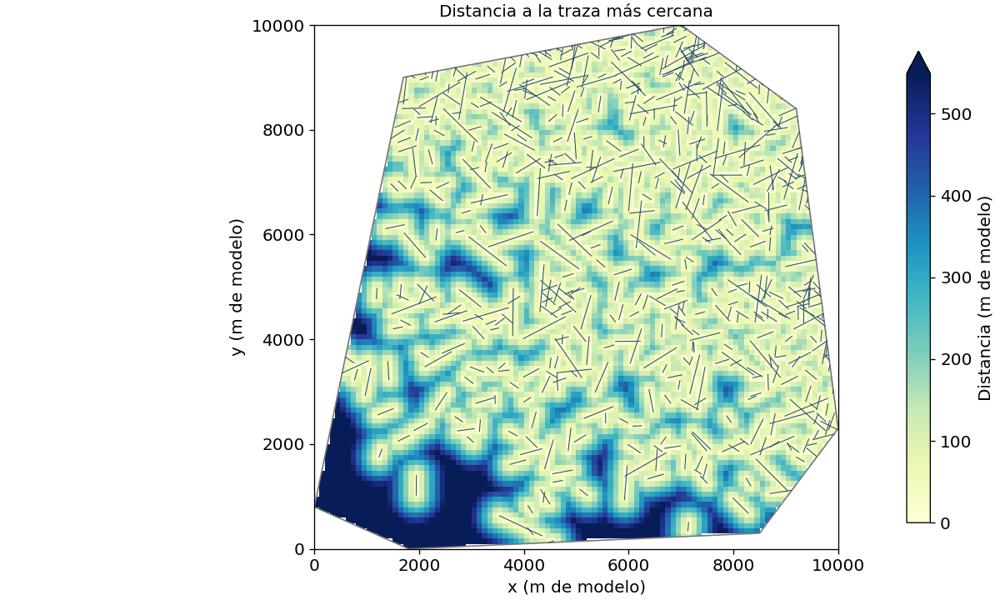

Figura 3. Distancia a la traza más cercana. Los valores pequeños siguen las trazas y los grandes marcan los huecos de la red; una distancia pequeña no implica una red densa. La escala de color se limita al percentil 95 de las distancias dentro del dominio.

### Diagrama de rosa

La rosa agrupa las orientaciones en intervalos angulares, aquí de 10°, y suma la longitud de cada intervalo. La orientación de una traza es axial, de modo que la rosa repite cada barra en el semicírculo opuesto; el norte queda arriba y el azimut crece en sentido horario. Sanderson y Peacock (2020) discuten las decisiones que conviene declarar al construirla: ponderación por número o por longitud, anchura de los intervalos y escala radial.

La Figura 4 recupera las tres familias de la red. La rosa es la herramienta adecuada para comparar direcciones con esfuerzos o estructuras regionales, pero al reunir toda el área pierde la posición de cada traza: redistribuir las mismas trazas por el polígono dejaría la rosa intacta. Tampoco dice nada de cómo cambian las concentraciones con la escala.

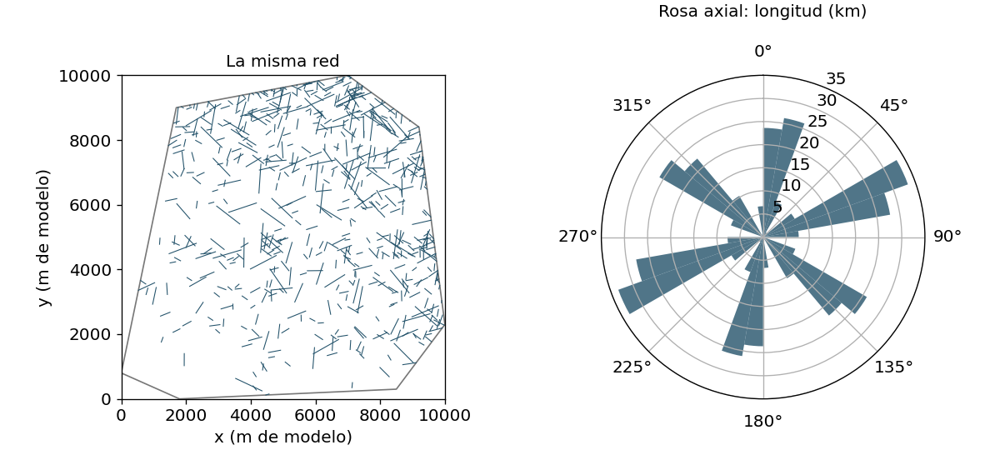

Figura 4. La rosa recupera las tres familias, pero suma en las mismas barras trazas de zonas densas y de zonas dispersas.

## 4. Fractalidad y multifractalidad

Los tres enfoques anteriores describen el mapa a una sola escala. La geometría fractal, desarrollada por Mandelbrot (1967, 1982), plantea la pregunta complementaria: cómo aumenta el detalle medido cuando se reduce la escala de observación. Mandelbrot la formuló a partir de un problema cartográfico, la longitud de una costa, que crece cuanto más corta es la regla con que se mide.

La curva de Koch de la Figura 5 muestra la idea en su forma más limpia. Cada segmento se sustituye por cuatro segmentos de un tercio de su longitud, y al ampliar cualquier parte reaparece la misma regla. Tras n pasos hay 4n segmentos de longitud 3−n, y la longitud total, (4/3)n, crece sin límite. La dimensión de la curva ideal es D = ln 4 / ln 3 = 1,261860.

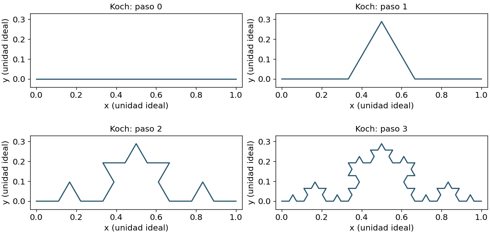

Figura 5. Al reducir la regla a un tercio aparecen cuatro piezas por cada pieza anterior. Los paneles son aproximaciones finitas; la dimensión indicada corresponde a la curva límite.

Una línea suave tiene dimensión uno y una superficie llena, dimensión dos. Una dimensión intermedia indica que, al reducir la escala, el detalle crece más deprisa que para una línea y más despacio que para un área. La geología adoptó pronto esta descripción para redes de fallas y fracturas: Hirata (1989) midió dimensiones de sistemas de fallas en Japón, La Pointe (1988) relacionó la dimensión con la densidad y la conectividad de fracturas, y Turcotte (1997), Bonnet y colaboradores (2001) y Kruhl (2013) sintetizan décadas de aplicaciones. Esas mismas revisiones insisten en una cautela: un conjunto finito de segmentos rectos tiende a dimensión uno a escalas suficientemente pequeñas, de modo que una dimensión intermedia describe un intervalo de escalas concreto y conviene declararlo.

La multifractalidad añade una segunda pregunta: si las zonas que concentran mucha longitud y las que concentran poca cambian de la misma forma al reducir la escala. La idea procede de la física de sistemas dinámicos, con las dimensiones generalizadas de Hentschel y Procaccia (1983) y Grassberger y Procaccia (1983) y el espectro de singularidades de Halsey y colaboradores (1986). En geociencias se aplicó a la distribución espacial de mineralizaciones y anomalías geoquímicas (Cheng y Agterberg, 1996; Cheng, 1999) y a patrones de fallas (Ouillon y colaboradores, 1996; Ouillon y Sornette, 1996). La Figura 6 usa una cascada ideal que reparte la medida en fracciones 0,10, 0,20, 0,25 y 0,45 cada vez que divide un cuadrado en cuatro. Al repetir la regla aparecen concentraciones con exponentes distintos, y la curva f(α) resume esa variedad.

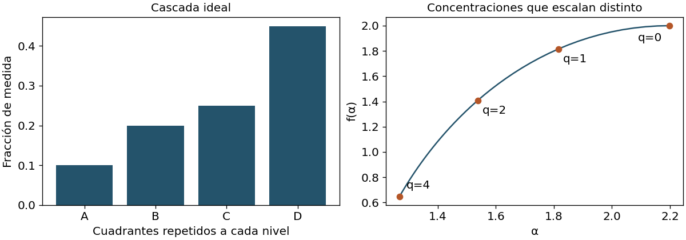

Figura 6. Cascada multiplicativa ideal y su espectro para q entre 0 y 4. Los valores ilustran el concepto y no proceden de la red de 627 trazas.

## 5. Cómo se aplica al mapa: box counting

El método más extendido para estimar la dimensión de un mapa es el conteo de cajas. Se cubre el mapa con una cuadrícula de lado ε, se cuentan las cajas que contienen alguna traza y se repite el conteo con cajas cada vez menores. La Figura 7 muestra la operación sobre la red común con lados de 2000, 1000 y 500 m.

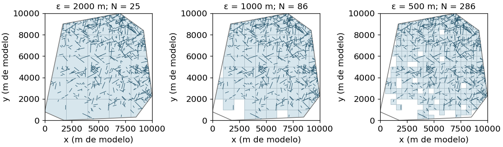

Figura 7. Las cajas azules contienen alguna traza. Al pasar de 2000 a 500 m de lado, el número de cajas ocupadas sube de 25 a 286.

Si al reducir el tamaño de caja el número de cajas ocupadas crece de forma regular, se propone una ley de potencia

::math N(ε) = C ε−D

donde C es una constante positiva. Tomando logaritmos,

::math ln N = constante + D ln(1 / ε)

de modo que D es la pendiente de una recta en el gráfico log–log, y una regresión lineal la estima junto con su R2. La Figura 8 muestra el caso más simple: una traza recta cubierta por cuatro cajas, y por ocho cuando el lado se reduce a la mitad.

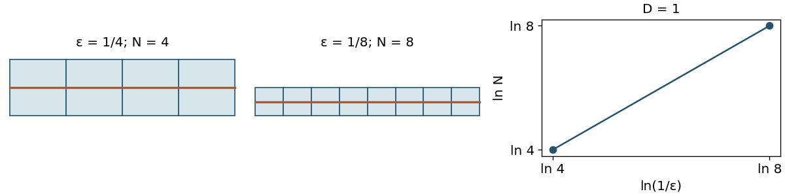

Figura 8. Al dividir ε por dos, N se duplica y la pendiente vale ln 2 / ln 2 = 1, la dimensión de una línea.

## 6. Qué pierde el conteo y qué puede ocultar la recta

### Una caja vale uno

El conteo clásico es binario: una caja vale uno si contiene alguna traza y cero si está vacía. La Figura 9 compara dos cajas de 100 m de lado. La primera contiene un fragmento de 10 m; la segunda, diez trazas de 100 m, mil metros en total. Ambas suman exactamente uno al conteo, y la diferencia de un factor cien en longitud desaparece. El conteo responde a cuánto espacio ocupa la red, pero no a cómo se reparte la longitud dentro de ese espacio, que es justamente lo que distingue un corredor de un fragmento aislado.

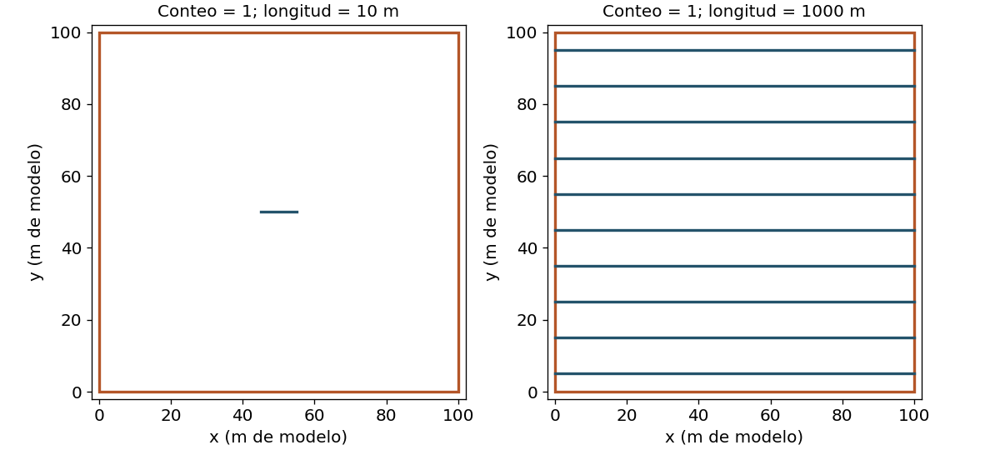

Figura 9. Dos cajas con el mismo conteo y longitudes de 10 m y 1000 m.

### De la longitud vectorial a la tinta rasterizada

Una práctica frecuente rasteriza el mapa antes de contar: cuenta píxeles ocupados o suma la masa de píxeles en cada caja. El resultado pasa a depender del tamaño de píxel, del grosor con que se dibujan las líneas y del suavizado. La masa de un ráster mide área de tinta, que se aproxima a la longitud solo de forma imperfecta, sobre todo donde las trazas se cruzan o su grosor se acerca al tamaño de caja. Walsh y Watterson (1993) mostraron que las decisiones de método en el conteo de cajas cambian la dimensión que se obtiene de un mismo patrón de fracturas.

Para medir el efecto se usa un mapa pequeño de once trazas, ocho de ellas cortas y agrupadas, en un cuadrado de 128 m, con cajas de 2 a 32 m y el mismo origen en ambas medidas. Se ensayan píxeles de 0,5, 1 y 2 m con grosores de uno y tres píxeles. La Figura 10 compara las pendientes.

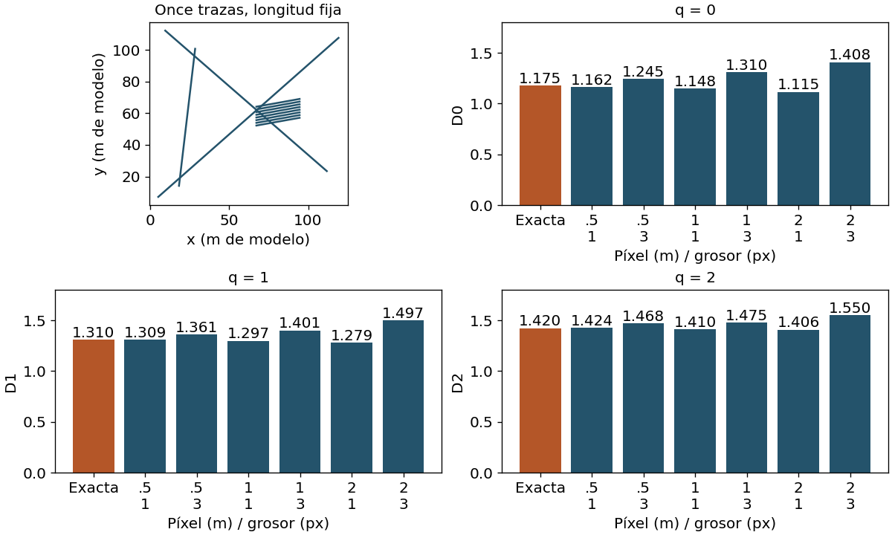

Figura 10. Pendientes D0, D1 y D2 del mismo mapa medido con longitud exacta y con seis rasterizaciones. Solo cambia la forma de medir; el mapa y el intervalo son los mismos.

Con la longitud exacta, 596,302087 m en todas las escalas, las pendientes son D0 = 1,174975, D1 = 1,309507 y D2 = 1,420472. Con píxel de 0,5 m y grosor de un píxel apenas cambian (1,162490, 1,309358 y 1,423804); con píxel de 2 m y grosor de tres píxeles suben a 1,407951, 1,497009 y 1,549651. El mapa no cambió: cambió el dibujo.

### Resolución, intervalo y curvatura

Las escalas que admite un mapa están acotadas por arriba y por abajo. Las cajas grandes reflejan el tamaño del dominio; las muy pequeñas siguen segmentos individuales y el detalle que retuvo la cartografía. Dentro de esos límites, una relación ligeramente curva puede parecer recta, y un R2 alto no basta para descartarlo: mide cuánto de la variación explica la recta en los puntos dados, no si la recta es el modelo adecuado. Gonzato y colaboradores (1998) examinan estos problemas de regresión y muestreo, y Malcai y colaboradores (1997) muestran que muchos estudios empíricos declaran fractalidad sobre intervalos de escala muy cortos.

La posición de la cuadrícula cambia las celdas que atraviesa cada traza, la forma del borde cambia el espacio disponible para las cajas, y el tamaño finito de la muestra sesga las estimaciones multifractales (Ouillon y Sornette, 1996). Lidar y colaboradores (1997) demostraron que segmentos colocados al azar producen un escalamiento aparente entre dos longitudes características, Wilson (2001) relacionó las transiciones en las curvas de conteo con el espaciamiento de las fracturas, y Roy y colaboradores (2007) propusieron fijar el límite inferior de escala a partir del comportamiento de los residuos. La conclusión común es declarar el intervalo de escalas y comprobar su estabilidad antes de interpretar una pendiente.

### Un ejemplo: R2 alto con curvatura sistemática

El mecanismo descrito por Lidar y colaboradores (1997) se reproduce colocando 100 segmentos de 1000 m al azar en un cuadrado de 10000 m y contando cajas en 24 tamaños entre 50 y 2000 m. El conteo clásico da D_BC = 1,236141 con R2 = 0,992364, un ajuste que muchos trabajos aceptarían sin más. Sin embargo, los residuos de la Figura 11 dibujan un arco: la recta se equivoca de forma sistemática, por exceso en el centro y por defecto en los extremos.

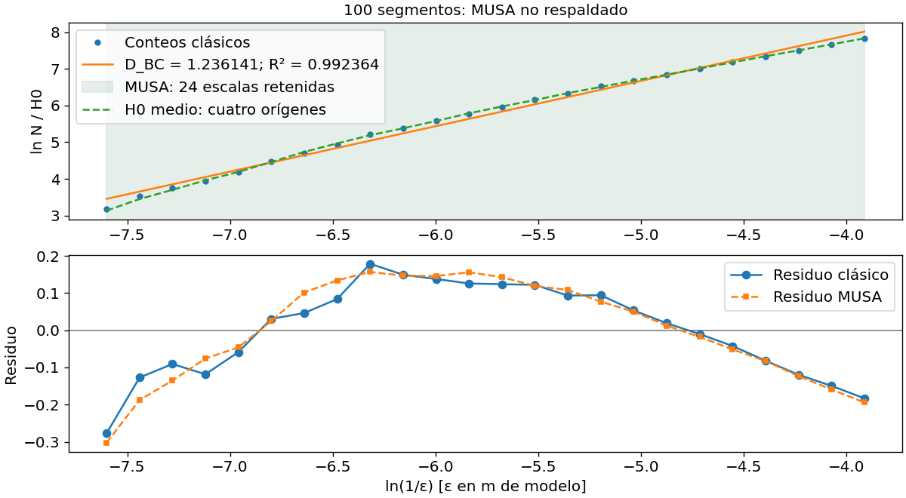

Figura 11. Arriba, conteos y recta clásica sobre las 24 escalas. Abajo, los residuos forman un arco en lugar de repartirse al azar.

El diagnóstico de MUSA, descrito en la sección 7, retiene las 24 escalas (1,6 décadas) y compara la recta con una curva y con dos tramos rectos, prediciendo cada escala a partir de las demás. Ambas alternativas predicen mejor que la recta: el error se reduce a un 25 % y a un 24 % del de la recta, una mejora normalizada de 0,030 frente al umbral de 0,03. El resultado para D0 es «no respaldado», aunque el margen sobre el umbral es pequeño y la conclusión se refiere a este diseño.

### Un contraejemplo: el Cantor y la falta de información

El caso inverso también existe. En un Cantor finito de siete niveles, con cajas de 10000/32 a 10000/35 m, el conteo clásico obtiene exactamente la dimensión teórica, ln 2 / ln 3 = 0,630930, con R2 = 1. MUSA no emite un valor porque solo hay cuatro escalas, frente a las ocho que exige su diseño por defecto, y declara «información insuficiente». Aquí el conteo clásico acierta y la abstención se debe únicamente al número de escalas. La Figura 12 resume el caso.

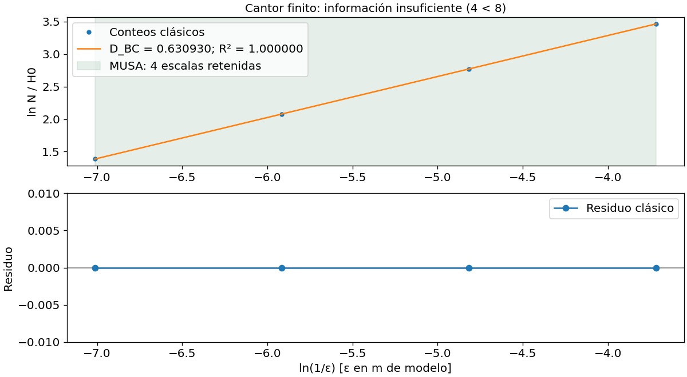

Figura 12. Los conteos 4, 8, 16 y 32 reproducen la pendiente del Cantor; con cuatro escalas, MUSA se abstiene.

## 7. Cómo lo calcula MUSA

MUSA no introduce una teoría nueva. Toma herramientas establecidas (la medida de longitud por caja, las entropías de Rényi, el método directo de Chhabra y Jensen, la validación cruzada y las pruebas de Monte Carlo) y las combina en un procedimiento que calcula la medida a partir de la geometría vectorial, evalúa si el intervalo de escalas respalda cada estimación y deja constancia de cuándo no lo hace.

### Longitud por celda

En lugar de marcar una caja como ocupada, MUSA le asigna la longitud de traza que contiene, la medida habitual en los análisis multifractales de redes de fallas (Ouillon y colaboradores, 1996). La diferencia está en cómo se calcula: las trazas se recortan al polígono observado, cada segmento se divide en sus cruces con las líneas de la cuadrícula y cada fragmento aporta su longitud geométrica a una única celda. La suma por celdas coincide así con la longitud total dentro del polígono en todas las escalas, sin pasar por un ráster. La fracción de longitud de cada celda ocupada es

::math pi = mi / Σj mj

donde mi es la longitud contenida en la celda i. La preparación de las trazas importa: trazas duplicadas contarían dos veces la misma longitud, y el diagnóstico rechaza las entradas con duplicados.

La Figura 13 muestra el paso de la longitud por celda a la ponderación por órdenes q. A la izquierda, la longitud de cada caja de 1000 m; a la derecha, el peso acumulado de las celdas ordenadas de mayor a menor longitud. Con q = 0 todas las celdas ocupadas pesan lo mismo; con q = 1 cada una pesa según su fracción de longitud, y con q = 2 el peso se concentra en las celdas más cargadas.

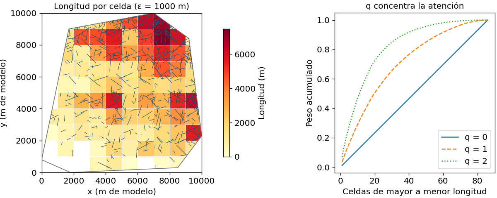

Figura 13. Longitud por celda (izquierda) y peso acumulado para q = 0, 1 y 2 (derecha). Cuanto mayor es q, más rápido se acumula el peso en pocas celdas.

### Entropías de Rényi y dimensiones generalizadas

Las dimensiones generalizadas se obtienen a partir de la entropía de Rényi (Rényi, 1961; Hentschel y Procaccia, 1983) de las fracciones de longitud en cada tamaño de caja:

::math Hq = ln(Σi piq) / (1 − q)

Para q = 0 la entropía se reduce al logaritmo del número de celdas ocupadas, H0 = ln N, y recupera el conteo clásico. Para q = 1 su límite es la entropía de Shannon, H1 = −Σi pi ln pi. La dimensión de orden q es la pendiente de Hq frente a ln(1/ε), cuando el intervalo respalda una relación lineal, y el exponente de masa se escribe

::math τ(q) = (q − 1) Dq

En la práctica, D0 describe cuánto espacio ocupa la red, D1 cómo se reparte la longitud y D2, la dimensión de correlación de Grassberger y Procaccia (1983), cuánto se concentra en las celdas más cargadas. Si D0, D1 y D2 coinciden, la longitud se reparte de forma homogénea entre escalas; si decrecen con q, unas pocas zonas concentran una parte creciente de la longitud al reducir la caja.

Los órdenes negativos dan más peso a las celdas con muy poca longitud. Una celda que la cuadrícula apenas roza contiene un fragmento diminuto, y esos fragmentos pueden dominar el cálculo. Las pruebas de MUSA con medidas conocidas muestran que los órdenes negativos son inestables, por lo que se presentan como indicadores de sensibilidad y no como dimensiones.

### Espectro de singularidades por el método directo

El espectro f(α) describe la variedad de concentraciones: α mide cómo decrece la fracción de longitud de una celda al reducir la caja, y f(α) es la dimensión del conjunto de celdas con ese exponente (Halsey y colaboradores, 1986). MUSA lo estima con el método directo de Chhabra y Jensen (1989; Chhabra y colaboradores, 1989), que evita derivar numéricamente τ(q). Para cada q se forman probabilidades auxiliares

::math μi(q) = piq / Σj pjq

y α(q) y f(α(q)) se obtienen como pendientes frente a ln(1/ε) de dos promedios logarítmicos:

::math α(q) = pendiente de −Σi μi ln pi

::math f(α(q)) = pendiente de −Σi μi ln μi

La relación f = qα − τ sirve como comprobación de consistencia. MUSA presenta por separado α en q = 0, el máximo observado de f y el vértice de un ajuste cuadrático, y deja huecos en la curva donde una estimación no tiene respaldo.

### Un intervalo declarado y tres resultados posibles

Lo que MUSA añade a estas herramientas es una evaluación explícita del intervalo de escalas, en la línea de las recomendaciones de Malcai y colaboradores (1997) y Roy y colaboradores (2007). El usuario declara la resolución de observación y los tamaños de caja. MUSA descarta las cajas menores que la resolución y las mayores que una fracción del lado corto del dominio, y fija el intervalo restante antes de ajustar. Por defecto exige al menos ocho escalas que abarquen una década.

Sobre ese intervalo repite el cálculo con cuatro orígenes de cuadrícula desplazados y promedia las curvas, examina cuánto cambia la pendiente al omitir escalas o recortar los extremos, y compara tres modelos (recta, curva cuadrática y dos tramos rectos, con el quiebre estimado como en Muggeo, 2003) mediante validación cruzada dejando fuera una escala cada vez (Stone, 1974). Cada orden q, y cada α y f, recibe uno de tres resultados:

- Compatible: el intervalo cumple los criterios de soporte, ajuste, estabilidad y forma, y la estimación describe ese intervalo.
- No respaldado: hay datos suficientes, pero falla alguno de esos criterios; el informe indica cuál.
- Información insuficiente: la resolución, la amplitud del intervalo, el número de escalas o el número de celdas ocupadas no permiten decidir, y el valor queda ausente.

Los umbrales de estos criterios se calibraron con medidas de dimensión conocida y se registran con cada ejecución.

### Recolocación condicional de trazas

La última pregunta es si la organización observada se distingue de una disposición sin estructura espacial. MUSA la aborda con una prueba de Monte Carlo en el sentido de Besag y Diggle (1977): cada traza se traslada a una posición aleatoria dentro del mismo polígono, conservando su forma, longitud y orientación, y se recalcula el contraste T = D0 − D2 en cada réplica. Cambian las posiciones y las intersecciones; se mantienen el número de trazas, la longitud total y la rosa de orientaciones. La prueba solo se ejecuta cuando D0 y D2 son compatibles.

Con B réplicas válidas, el valor p de cola superior se calcula como recomiendan Phipson y Smyth (2010):

::math p = (1 + número de T simulados ≥ T observado) / (B + 1)

La versión bilateral duplica la cola menor, de modo que el menor p alcanzable es 2/(B + 1). Cuando se evalúan varios soportes, el ajuste de Holm (1979) controla el error de la familia. Un resultado significativo indica organización espacial respecto a este modelo de recolocación; su explicación geológica requiere información del terreno.

## 8. Lectura de resultados y reporte de un análisis

La pestaña Results separa el cálculo descriptivo del diagnóstico de escalamiento. La tabla por q muestra cada estimación con su estado y su motivo: los valores en gris conservan un cálculo sin respaldo y un guion marca un valor ausente. Un Dq compatible puede convivir con α o f ausentes, porque cada observable se evalúa por separado. Las estimaciones ponderadas por zeta, que pesan cada escala local según su soporte numérico, se presentan aparte de las canónicas. En las ventanas móviles, el solapamiento entre ventanas hace que sus estimaciones no sean independientes.

Si se activa la opción Box counting clásico (solo comparación), un panel aparte muestra D_BC y R2 calculados con todas las escalas de entrada y un único origen, junto al D0 de MUSA, su estado y el intervalo retenido. La comparación ayuda a situar un resultado frente a la práctica habitual; las diferencias suelen deberse al intervalo y al origen de la cuadrícula.

Un informe de análisis debería incluir:

1. El polígono observado y sus huecos, el sistema de coordenadas, el objeto medido y la preparación de las trazas, incluido el tratamiento de duplicados.
2. La resolución de observación, los tamaños de caja solicitados y retenidos, las escalas excluidas con su motivo y la amplitud retenida en décadas.
3. El rango de q, y para cada observable su valor, estado y motivo, incluidos los rechazos y los valores ausentes; los órdenes negativos, como indicadores de sensibilidad.
4. La sensibilidad al origen y a la omisión de escalas, la comparación de modelos y los umbrales usados.
5. Para la recolocación: el contraste y la cola, la semilla, las réplicas solicitadas y válidas, la familia de pruebas con el ajuste de Holm y el menor p alcanzable.
6. La versión del software, la receta completa y la procedencia de las entradas, junto con las salidas y el manifiesto guardados.

### Reproducción

Los ejemplos y las figuras se regeneran con scripts/tutorial_network.py (red de referencia, semilla 20261122), scripts/knowledge_examples.py (segmentos aleatorios, semilla 42) y scripts/build_narrative_figures.py. Las cifras citadas se guardan en docs/images/knowledge_narrative_measurements.json, y el cuaderno 03 repite la comparación entre el conteo clásico y la longitud exacta.

## Fuentes

- Berkowitz, B. (2002). [Characterizing flow and transport in fractured geological media: A review](https://doi.org/10.1016/S0309-1708(02)00042-8). Advances in Water Resources.
- Besag, J. y Diggle, P. J. (1977). [Simple Monte Carlo tests for spatial pattern](https://doi.org/10.2307/2346974). Applied Statistics.
- Bonnet, E., Bour, O., Odling, N. E., Davy, P., Main, I., Cowie, P. y Berkowitz, B. (2001). [Scaling of fracture systems in geological media](https://doi.org/10.1029/1999RG000074). Reviews of Geophysics.
- Casas, A. M., Cortés, A. L., Maestro, A., Soriano, M. A., Riaguas, A. y Bernal, J. (2000). [LINDENS: A program for lineament length and density analysis](https://doi.org/10.1016/S0098-3004(00)00017-0). Computers & Geosciences.
- Cheng, Q. (1999). [Multifractality and spatial statistics](https://doi.org/10.1016/S0098-3004(99)00060-6). Computers & Geosciences.
- Cheng, Q. y Agterberg, F. P. (1996). [Multifractal modeling and spatial statistics](https://doi.org/10.1007/BF02273520). Mathematical Geology.
- Chhabra, A. y Jensen, R. V. (1989). [Direct determination of the f(α) singularity spectrum](https://doi.org/10.1103/PhysRevLett.62.1327). Physical Review Letters.
- Chhabra, A. B., Meneveau, C., Jensen, R. V. y Sreenivasan, K. R. (1989). [Direct determination of the f(α) singularity spectrum and its application to fully developed turbulence](https://doi.org/10.1103/PhysRevA.40.5284). Physical Review A.
- Gonzato, G., Mulargia, F. y Marzocchi, W. (1998). [Practical application of fractal analysis: problems and solutions](https://doi.org/10.1046/j.1365-246x.1998.00461.x). Geophysical Journal International.
- Grassberger, P. y Procaccia, I. (1983). [Characterization of strange attractors](https://doi.org/10.1103/PhysRevLett.50.346). Physical Review Letters.
- Halsey, T. C., Jensen, M. H., Kadanoff, L. P., Procaccia, I. y Shraiman, B. I. (1986). [Fractal measures and their singularities: The characterization of strange sets](https://doi.org/10.1103/PhysRevA.33.1141). Physical Review A.
- Healy, D., Rizzo, R. E., Cornwell, D. G., Farrell, N. J. C., Watkins, H., Timms, N. E., Gomez-Rivas, E. y Smith, M. (2017). [FracPaQ: A MATLAB toolbox for the quantification of fracture patterns](https://doi.org/10.1016/j.jsg.2016.12.003). Journal of Structural Geology.
- Hentschel, H. G. E. y Procaccia, I. (1983). [The infinite number of generalized dimensions of fractals and strange attractors](https://doi.org/10.1016/0167-2789(83)90235-X). Physica D.
- Hirata, T. (1989). [Fractal dimension of fault systems in Japan: Fractal structure in rock fracture geometry at various scales](https://doi.org/10.1007/BF00874485). Pure and Applied Geophysics.
- Holm, S. (1979). A simple sequentially rejective multiple test procedure. Scandinavian Journal of Statistics, 6, 65–70.
- Kruhl, J. H. (2013). [Fractal-geometry techniques in the quantification of complex rock structures: A special view on scaling regimes, inhomogeneity and anisotropy](https://doi.org/10.1016/j.jsg.2012.10.002). Journal of Structural Geology.
- La Pointe, P. R. (1988). [A method to characterize fracture density and connectivity through fractal geometry](https://doi.org/10.1016/0148-9062(88)90982-5). International Journal of Rock Mechanics and Mining Sciences & Geomechanics Abstracts.
- Lidar, D. A., Biham, O. y Avnir, D. (1997). [Limited range fractality of randomly adsorbed rods](https://doi.org/10.1063/1.474070). Journal of Chemical Physics.
- Malcai, O., Lidar, D. A., Biham, O. y Avnir, D. (1997). [Scaling range and cutoffs in empirical fractals](https://doi.org/10.1103/PhysRevE.56.2817). Physical Review E.
- Mandelbrot, B. B. (1967). [How long is the coast of Britain? Statistical self-similarity and fractional dimension](https://doi.org/10.1126/science.156.3775.636). Science.
- Mandelbrot, B. B. (1982). The Fractal Geometry of Nature. W. H. Freeman, San Francisco.
- Mauldon, M., Dunne, W. M. y Rohrbaugh, M. B. (2001). [Circular scanlines and circular windows: new tools for characterizing the geometry of fracture traces](https://doi.org/10.1016/S0191-8141(00)00094-8). Journal of Structural Geology.
- Muggeo, V. M. R. (2003). [Estimating regression models with unknown break-points](https://doi.org/10.1002/sim.1545). Statistics in Medicine.
- Nykänen, V., Groves, D. I., Ojala, V. J., Eilu, P. y Gardoll, S. J. (2008). [Reconnaissance-scale conceptual fuzzy-logic prospectivity modelling for iron oxide copper–gold deposits in the northern Fennoscandian Shield, Finland](https://doi.org/10.1080/08120090701581372). Australian Journal of Earth Sciences.
- Ouillon, G., Castaing, C. y Sornette, D. (1996). [Hierarchical geometry of faulting](https://doi.org/10.1029/95JB02242). Journal of Geophysical Research: Solid Earth.
- Ouillon, G. y Sornette, D. (1996). [Unbiased multifractal analysis: Application to fault patterns](https://doi.org/10.1029/96GL02379). Geophysical Research Letters.
- Phipson, B. y Smyth, G. K. (2010). [Permutation p-values should never be zero: calculating exact p-values when permutations are randomly drawn](https://doi.org/10.2202/1544-6115.1585). Statistical Applications in Genetics and Molecular Biology.
- Rényi, A. (1961). On measures of entropy and information. Proceedings of the Fourth Berkeley Symposium on Mathematical Statistics and Probability, 1, 547–561.
- Roy, A., Perfect, E., Dunne, W. M. y McKay, L. D. (2007). [Fractal characterization of fracture networks: An improved box-counting technique](https://doi.org/10.1029/2006JB004582). Journal of Geophysical Research: Solid Earth.
- Sander, P. (2007). [Lineaments in groundwater exploration: a review of applications and limitations](https://doi.org/10.1007/s10040-006-0138-9). Hydrogeology Journal.
- Sanderson, D. J. y Nixon, C. W. (2015). [The use of topology in fracture network characterization](https://doi.org/10.1016/j.jsg.2015.01.005). Journal of Structural Geology.
- Sanderson, D. J. y Peacock, D. C. P. (2020). [Making rose diagrams fit-for-purpose](https://doi.org/10.1016/j.earscirev.2019.103055). Earth-Science Reviews.
- Stone, M. (1974). [Cross-validatory choice and assessment of statistical predictions](https://doi.org/10.1111/j.2517-6161.1974.tb00994.x). Journal of the Royal Statistical Society, Series B.
- Turcotte, D. L. (1997). [Fractals and Chaos in Geology and Geophysics](https://doi.org/10.1017/CBO9781139174695), 2.ª ed. Cambridge University Press.
- Walsh, J. J. y Watterson, J. (1993). [Fractal analysis of fracture patterns using the standard box-counting technique: valid and invalid methodologies](https://doi.org/10.1016/0191-8141(93)90010-8). Journal of Structural Geology.
- Wilson, T. H. (2001). [Scale transitions in fracture and active fault networks](https://doi.org/10.1023/A:1011096828971). Mathematical Geology.

Las fórmulas completas, los valores por defecto y el alcance de las evaluaciones de MUSA se documentan en el repositorio, en las guías de [teoría](https://github.com/jordan-zav/MUSA/blob/main/docs/theory.md), de [respaldo de escalamiento](https://github.com/jordan-zav/MUSA/blob/main/docs/SCALING_SUPPORT.md), de [órdenes negativos](https://github.com/jordan-zav/MUSA/blob/main/docs/NEGATIVE_Q.md) y de [espectros](https://github.com/jordan-zav/MUSA/blob/main/docs/SPECTRA.md).
