# Learn: how a fracture network is organized

## 1. How structural patterns are analyzed

For a long time, structural analysis in geology has often been reduced to a density map, a Euclidean distance to structures, or a fractal dimension obtained from a single fit. Each of these summaries answers a different question: where traces accumulate, how far the nearest one lies, which orientations dominate, or how much space the network occupies. This chapter goes through them one by one on the same map, shows what each keeps and what it leaves out, and so arrives at the question MUSA addresses: how the organization of the network changes as the scale of observation changes.

The chapter starts with the geological object, continues with the usual approaches and then builds up the ideas of fractality, box counting and multifractality, which come from a broad literature. The last sections explain what MUSA does with these tools and how to read its results. All examples are synthetic and expressed in model metres without a geographic location; they show how each measure works and are not an interpretation of any particular terrain.

## 2. The geological basis: from outcrop to map

A fracture is a discontinuity in rock, and its intersection with an observation surface leaves a trace. A trace map records those intersections, or their interpretation, on an outcrop, an image or a relief model. A lineament is a linear feature recognizable in an image, in topography or in a geophysical field; it may correspond to a fault, a joint system, a lithological contact or a geomorphological alignment, and its nature is established by comparing sources and field observations. Sander (2007) reviews this range of uses and the limits of interpreting lineaments as conductive fractures.

At outcrop, orientation, visible length, aperture, fill and cross-cutting relations are measured. Aerial photographs, satellite images and relief models extend the coverage and allow trace families to be followed, although vegetation, illumination and resolution limit what can be recognized. Geophysics helps interpret structures under cover, with its own resolution and ambiguity. The final map carries the detection, generalization and connection decisions of each source, and these are worth keeping in mind when measuring it.

Fractures open pathways for fluid flow or act as barriers when sealed. Their connectivity, aperture and fill control permeability, hydrothermal circulation may be associated with mineralization, and the orientation and persistence of discontinuities affect the stability of blocks and slopes. Berkowitz (2002) reviews the link between fracture networks and transport, and Bonnet and co-authors (2001) compile the scaling laws observed in fracture systems, from thin section to regional scale. Geometry is one part of the problem: two networks with the same total length can be connected very differently (Sanderson and Nixon, 2015), and a geometric concentration needs geological context before it can be associated with a physical property.

Hence the interest in knowing whether trace concentrations persist from outcrop to district scale, or whether a characteristic spacing between corridors appears. To compare the answers of each approach, Figure 1 sets a common map: 627 traces in three families, centred on 20°, 80° and 140° from the x axis with dispersion, inside an irregular observation polygon. The grey polygon marks where observations were made; outside it there is no inventory.

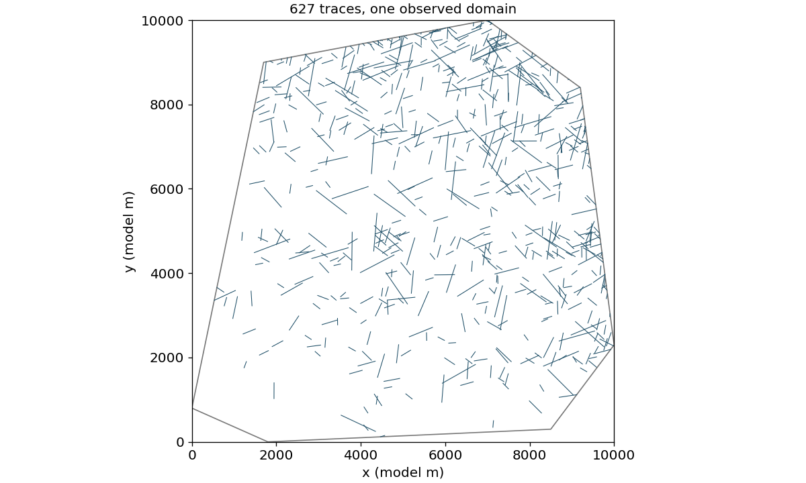

Figure 1. Reference network with 627 traces. Dense zones and nearly empty sectors belong to the same inventory, and all following comparisons use this network and this domain.

## 3. What the usual approaches answer

### Length density

The most direct way to recognize fractured corridors is to add up the trace length inside a circle of radius r and divide it by the observed area of that circle:

::math ρr(x) = Σ length(trace ∩ circle ∩ domain) / area(circle ∩ domain)

The result is expressed in m/m2 and is equivalent to the P21 intensity of the fracture literature; Mauldon and co-authors (2001) derive estimators of this quantity with circular windows. Because it uses length, a long trace weighs more than a short one. Programs such as LINDENS (Casas and co-authors, 2000) and FracPaQ (Healy and co-authors, 2017) produce these maps routinely, and in both the cell or window size is a user choice.

Figure 2 applies a 1000 m radius on a 100 m grid. At the boundary, the denominator is only the part of the circle inside the polygon, so the estimate always refers to the observed surface. The map shows clearly where length accumulates at that radius. A larger radius smooths the contrasts and a smaller one highlights local clusters; each choice describes a single neighbourhood scale, and seeing how the organization changes requires repeating the calculation with several radii and comparing them.

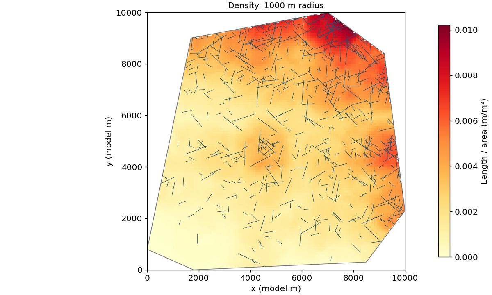

Figure 2. Length per unit area with a 1000 m radius. Red tones mark the corridors that concentrate length at that radius; there is no estimate outside the polygon.

### Euclidean distance to structures

Prospectivity models commonly turn structures into a proximity map, on the idea that closeness to a fluid corridor favours mineralization. The distance to the nearest trace is defined as

::math d(x) = min { distance(x, y) : y belongs to the traces }

Nykänen and co-authors (2008) illustrate this use in a prospectivity model for IOCG deposits; the geological relevance of each structure is decided before its distance is turned into evidence. Figure 3 computes d(x) on the same 100 m grid.

The map answers how far one must move to reach a mapped structure, and nothing more. A point next to an isolated trace receives the same value as one inside a corridor with dozens of traces. Distance keeps the minimum proximity and loses the amount of surrounding length, the connectivity and any variation between scales.

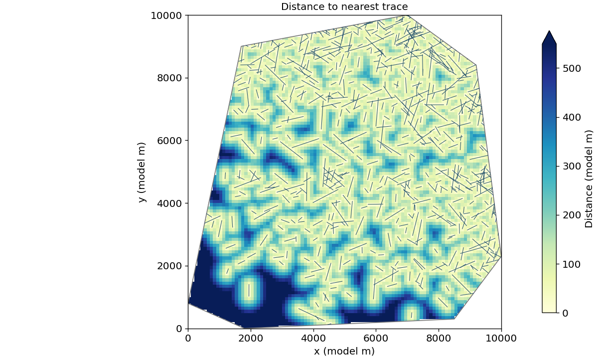

Figure 3. Distance to the nearest trace. Small values follow the traces and large ones mark the gaps in the network; a small distance does not imply a dense network. The colour scale is capped at the 95th percentile of distances inside the domain.

### Rose diagram

The rose groups orientations into angular bins, here 10° wide, and adds up the length in each bin. Trace orientation is axial, so the rose repeats each bar in the opposite half circle; north is up and azimuth increases clockwise. Sanderson and Peacock (2020) discuss the decisions worth declaring when building it: weighting by number or by length, bin width and radial scale.

Figure 4 recovers the three families of the network. The rose is the right tool for comparing directions with regional stresses or structures, but by pooling the whole area it loses the position of each trace: redistributing the same traces across the polygon would leave the rose unchanged. It also says nothing about how concentrations change with scale.

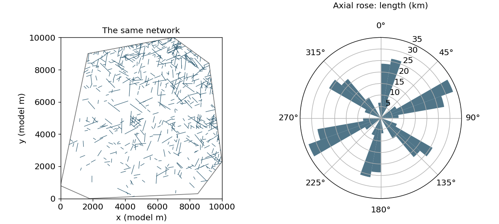

Figure 4. The rose recovers the three families, but adds traces from dense and sparse zones to the same bars.

## 4. Fractality and multifractality

The three approaches above describe the map at a single scale. Fractal geometry, developed by Mandelbrot (1967, 1982), asks the complementary question: how the measured detail grows as the scale of observation shrinks. Mandelbrot framed it with a cartographic problem, the length of a coastline, which grows the shorter the ruler used to measure it.

The Koch curve in Figure 5 shows the idea in its cleanest form. Each segment is replaced by four segments one third as long, and enlarging any part reveals the same rule. After n steps there are 4n segments of length 3−n, and the total length, (4/3)n, grows without bound. The dimension of the ideal curve is D = ln 4 / ln 3 = 1.261860.

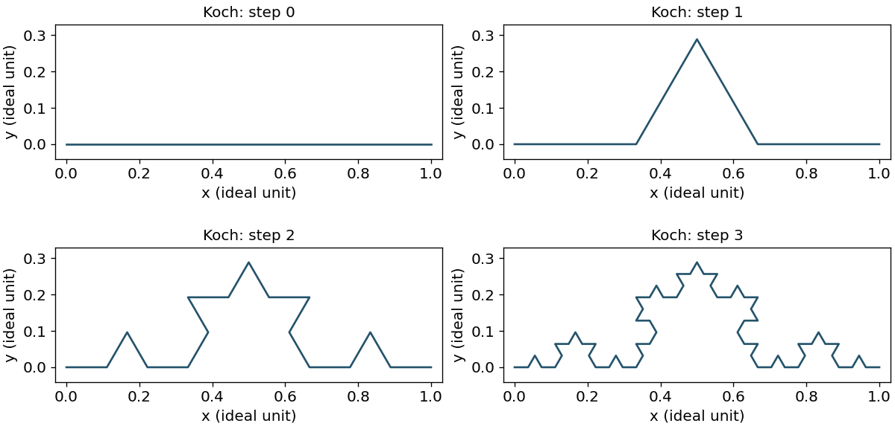

Figure 5. Reducing the ruler to one third yields four pieces for each previous piece. The panels are finite approximations; the stated dimension refers to the limit curve.

A smooth line has dimension one and a filled surface has dimension two. An intermediate dimension means that, as the scale shrinks, detail grows faster than for a line and more slowly than for an area. Geology adopted this description early for fault and fracture networks: Hirata (1989) measured the dimensions of fault systems in Japan, La Pointe (1988) related dimension to fracture density and connectivity, and Turcotte (1997), Bonnet and co-authors (2001) and Kruhl (2013) synthesize decades of applications. The same reviews stress a caution: a finite set of straight segments tends to dimension one at sufficiently small scales, so an intermediate dimension describes a specific range of scales, which should be declared.

Multifractality adds a second question: whether zones that concentrate much length and zones that concentrate little change in the same way as the scale shrinks. The idea comes from the physics of dynamical systems, with the generalized dimensions of Hentschel and Procaccia (1983) and Grassberger and Procaccia (1983) and the singularity spectrum of Halsey and co-authors (1986). In the geosciences it has been applied to the spatial distribution of mineralization and geochemical anomalies (Cheng and Agterberg, 1996; Cheng, 1999) and to fault patterns (Ouillon and co-authors, 1996; Ouillon and Sornette, 1996). Figure 6 uses an ideal cascade that splits the measure into fractions 0.10, 0.20, 0.25 and 0.45 each time a square is divided into four. Repeating the rule produces concentrations with different exponents, and the f(α) curve summarizes that variety.

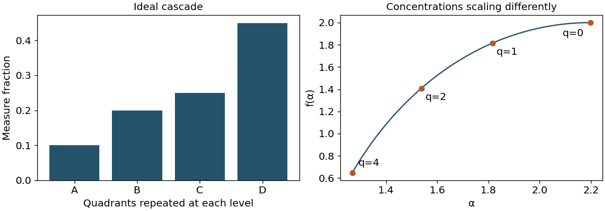

Figure 6. Ideal multiplicative cascade and its spectrum for q between 0 and 4. The values illustrate the concept and do not come from the 627-trace network.

## 5. Applying it to a map: box counting

The most widespread method for estimating the dimension of a map is box counting. The map is covered with a grid of side ε, the boxes containing any trace are counted, and the count is repeated with ever smaller boxes. Figure 7 shows the operation on the common network with sides of 2000, 1000 and 500 m.

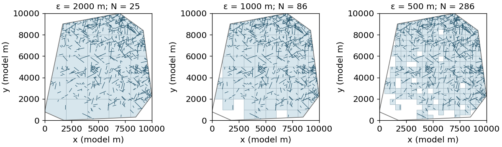

Figure 7. Blue boxes contain some trace. Going from 2000 to 500 m sides, the number of occupied boxes rises from 25 to 286.

If the number of occupied boxes grows regularly as the box size shrinks, a power law is proposed

::math N(ε) = C ε−D

where C is a positive constant. Taking logarithms,

::math ln N = constant + D ln(1 / ε)

so D is the slope of a straight line on the log–log plot, and a linear regression estimates it together with its R2. Figure 8 shows the simplest case: one straight trace covered by four boxes, and by eight when the side is halved.

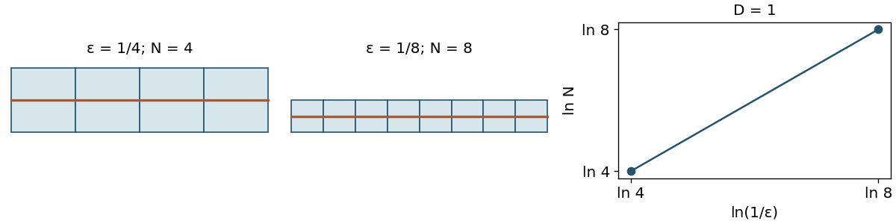

Figure 8. Halving ε doubles N, and the slope is ln 2 / ln 2 = 1, the dimension of a line.

## 6. What counting loses and what the line can hide

### A box counts as one

Classic box counting is binary: a box counts one if it contains any trace and zero if it is empty. Figure 9 compares two boxes 100 m wide. The first contains a 10 m fragment; the second, ten traces of 100 m, a thousand metres in total. Both add exactly one to the count, and the hundredfold difference in length disappears. The count answers how much space the network occupies, but not how length is distributed within that space, which is precisely what distinguishes a corridor from an isolated fragment.

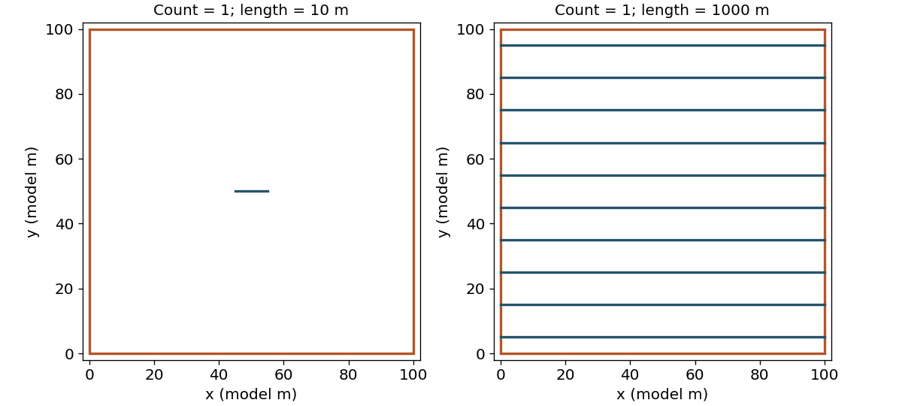

Figure 9. Two boxes with the same count and lengths of 10 m and 1000 m.

### From vector length to rasterized ink

A frequent practice rasterizes the map before counting: it counts occupied pixels or adds up pixel mass in each box. The result then depends on pixel size, on the width with which lines are drawn and on anti-aliasing. Raster mass measures ink area, which approximates length only imperfectly, especially where traces cross or their width approaches the box size. Walsh and Watterson (1993) showed that methodological decisions in box counting change the dimension obtained from the same fracture pattern.

To measure the effect, a small map of eleven traces, eight of them short and clustered, is placed in a 128 m square, with boxes from 2 to 32 m and the same origin for both measures. Pixels of 0.5, 1 and 2 m are tested with line widths of one and three pixels. Figure 10 compares the slopes.

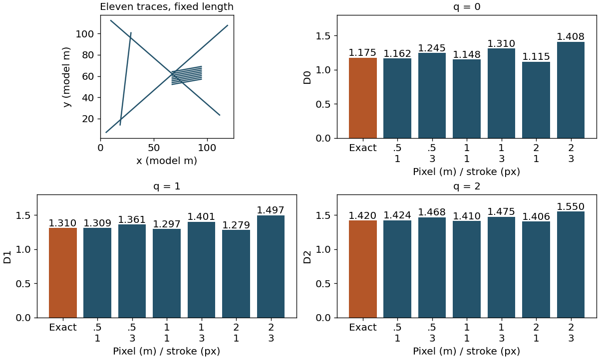

Figure 10. Slopes D0, D1 and D2 of the same map measured with exact length and with six rasterizations. Only the way of measuring changes; the map and the range are the same.

With exact length, 596.302087 m at every scale, the slopes are D0 = 1.174975, D1 = 1.309507 and D2 = 1.420472. With 0.5 m pixels and a one-pixel width they barely change (1.162490, 1.309358 and 1.423804); with 2 m pixels and a three-pixel width they rise to 1.407951, 1.497009 and 1.549651. The map did not change: the drawing did.

### Resolution, range and curvature

The scales a map admits are bounded above and below. Large boxes reflect the size of the domain; very small ones follow individual segments and the detail retained by the mapping. Within those limits, a slightly curved relation can look straight, and a high R2 is not enough to rule this out: it measures how much of the variation the line explains at the given points, not whether a line is the right model. Gonzato and co-authors (1998) examine these regression and sampling problems, and Malcai and co-authors (1997) show that many empirical studies report fractality over very short ranges of scale.

The position of the grid changes the cells each trace crosses, the shape of the boundary changes the space available to the boxes, and finite sample size biases multifractal estimates (Ouillon and Sornette, 1996). Lidar and co-authors (1997) demonstrated that randomly placed segments produce apparent scaling between two characteristic lengths, Wilson (2001) related transitions in counting curves to fracture spacing, and Roy and co-authors (2007) proposed setting the lower scale limit from the behaviour of the residuals. The common conclusion is to declare the range of scales and check its stability before interpreting a slope.

### An example: high R2 with systematic curvature

The mechanism described by Lidar and co-authors (1997) is reproduced by placing 100 segments of 1000 m at random in a 10000 m square and counting boxes at 24 sizes between 50 and 2000 m. Classic counting gives D_BC = 1.236141 with R2 = 0.992364, a fit many studies would accept as it stands. However, the residuals in Figure 11 trace an arc: the line errs systematically, too high in the middle and too low at both ends.

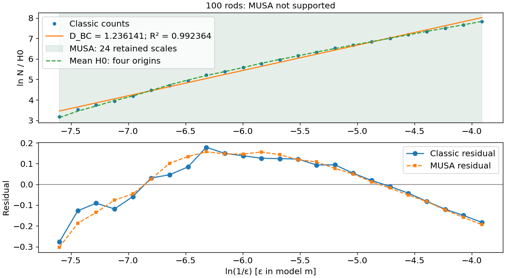

Figure 11. Top, counts and classic line over the 24 scales. Bottom, the residuals form an arc instead of scattering at random.

The MUSA assessment, described in section 7, retains all 24 scales (1.6 decades) and compares the line with a curve and with two straight segments, predicting each scale from the others. Both alternatives predict better than the line: the error drops to 25 % and 24 % of the line's error, a normalized improvement of 0.030 against a threshold of 0.03. The result for D0 is "not supported", although the margin over the threshold is small and the conclusion refers to this design.

### A counterexample: the Cantor set and missing information

The reverse case also exists. In a seven-level finite Cantor set, with boxes from 10000/32 to 10000/35 m, classic counting recovers exactly the theoretical dimension, ln 2 / ln 3 = 0.630930, with R2 = 1. MUSA reports no value because there are only four scales, against the eight its default design requires, and declares "insufficient information". Here classic counting is right and the abstention is due solely to the number of scales. Figure 12 summarizes the case.

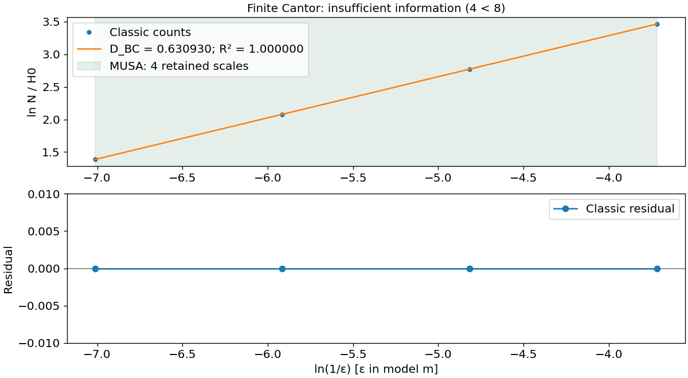

Figure 12. Counts of 4, 8, 16 and 32 reproduce the Cantor slope; with four scales, MUSA abstains.

## 7. How MUSA computes it

MUSA introduces no new theory. It takes established tools (the length-per-box measure, Rényi entropies, the direct method of Chhabra and Jensen, cross-validation and Monte Carlo tests) and combines them in a procedure that computes the measure from vector geometry, assesses whether the range of scales supports each estimate, and records when it does not.

### Length per cell

Instead of marking a box as occupied, MUSA assigns it the trace length it contains, the usual measure in multifractal analyses of fault networks (Ouillon and co-authors, 1996). The difference lies in how it is computed: traces are clipped to the observed polygon, each segment is split at its crossings with the grid lines, and each fragment contributes its geometric length to a single cell. The sum over cells thus equals the total length inside the polygon at every scale, without passing through a raster. The length fraction of each occupied cell is

::math pi = mi / Σj mj

where mi is the length contained in cell i. Trace preparation matters: duplicate traces would count the same length twice, and the assessment rejects inputs with duplicates.

Figure 13 shows the step from length per cell to weighting by order q. On the left, the length of each 1000 m box; on the right, the cumulative weight of cells sorted from most to least length. With q = 0 every occupied cell weighs the same; with q = 1 each weighs according to its length fraction, and with q = 2 the weight concentrates in the most loaded cells.

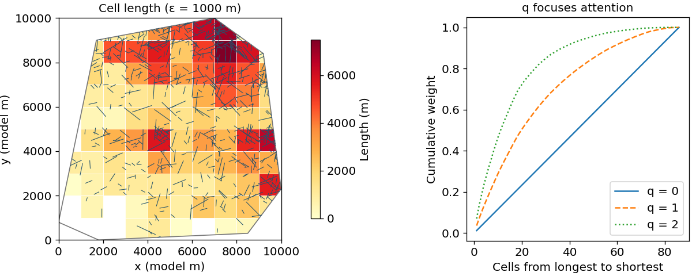

Figure 13. Length per cell (left) and cumulative weight for q = 0, 1 and 2 (right). The larger q is, the faster the weight accumulates in a few cells.

### Rényi entropies and generalized dimensions

Generalized dimensions are obtained from the Rényi entropy (Rényi, 1961; Hentschel and Procaccia, 1983) of the length fractions at each box size:

::math Hq = ln(Σi piq) / (1 − q)

For q = 0 the entropy reduces to the logarithm of the number of occupied cells, H0 = ln N, and recovers classic counting. For q = 1 its limit is the Shannon entropy, H1 = −Σi pi ln pi. The dimension of order q is the slope of Hq against ln(1/ε), when the range supports a linear relation, and the mass exponent is written

::math τ(q) = (q − 1) Dq

In practice, D0 describes how much space the network occupies, D1 how length is distributed, and D2, the correlation dimension of Grassberger and Procaccia (1983), how much it concentrates in the most loaded cells. If D0, D1 and D2 coincide, length is distributed homogeneously across scales; if they decrease with q, a few zones hold a growing share of the length as the box shrinks.

Negative orders give more weight to cells with very little length. A cell barely grazed by the grid contains a tiny fragment, and such fragments can dominate the calculation. MUSA's tests with known measures show that negative orders are unstable, so they are presented as sensitivity indicators rather than as dimensions.

### Singularity spectrum by the direct method

The f(α) spectrum describes the variety of concentrations: α measures how a cell's length fraction decreases as the box shrinks, and f(α) is the dimension of the set of cells with that exponent (Halsey and co-authors, 1986). MUSA estimates it with the direct method of Chhabra and Jensen (1989; Chhabra and co-authors, 1989), which avoids numerically differentiating τ(q). For each q, auxiliary probabilities are formed

::math μi(q) = piq / Σj pjq

and α(q) and f(α(q)) are obtained as slopes against ln(1/ε) of two logarithmic averages:

::math α(q) = slope of −Σi μi ln pi

::math f(α(q)) = slope of −Σi μi ln μi

The relation f = qα − τ serves as a consistency check. MUSA reports α at q = 0, the observed maximum of f and the vertex of a quadratic fit separately, and leaves gaps in the curve where an estimate has no support.

### A declared range and three possible results

What MUSA adds to these tools is an explicit assessment of the range of scales, in line with the recommendations of Malcai and co-authors (1997) and Roy and co-authors (2007). The user declares the observation resolution and the box sizes. MUSA discards boxes smaller than the resolution and larger than a fraction of the short side of the domain, and fixes the remaining range before fitting. By default it requires at least eight scales spanning one decade.

Over that range it repeats the calculation with four shifted grid origins and averages the curves, examines how much the slope changes when scales are omitted or the ends trimmed, and compares three models (a straight line, a quadratic curve and two straight segments, with the break estimated as in Muggeo, 2003) by leave-one-scale-out cross-validation (Stone, 1974). Each order q, and each α and f, receives one of three results:

- Compatible: the range meets the support, fit, stability and shape criteria, and the estimate describes that range.
- Not supported: there are enough data, but one of those criteria fails; the report states which.
- Insufficient information: resolution, range width, number of scales or number of occupied cells do not allow a decision, and the value stays missing.

The thresholds of these criteria were calibrated with measures of known dimension and are recorded with every run.

### Conditional trace relocation

The last question is whether the observed organization differs from an arrangement without spatial structure. MUSA addresses it with a Monte Carlo test in the sense of Besag and Diggle (1977): each trace is moved to a random position inside the same polygon, keeping its shape, length and orientation, and the contrast T = D0 − D2 is recomputed in each replicate. Positions and intersections change; the number of traces, the total length and the orientation rose are kept. The test runs only when D0 and D2 are compatible.

With B valid replicates, the upper-tail p-value is computed as recommended by Phipson and Smyth (2010):

::math p = (1 + number of simulated T ≥ observed T) / (B + 1)

The two-sided version doubles the smaller tail, so the smallest attainable p is 2/(B + 1). When several supports are assessed, the Holm (1979) adjustment controls the family-wise error. A significant result indicates spatial organization relative to this relocation model; its geological explanation requires information from the terrain.

## 8. Reading results and reporting an analysis

The Results tab separates the descriptive calculation from the scaling assessment. The per-q table shows each estimate with its status and reason: grey values keep an unsupported calculation and a dash marks a missing value. A compatible Dq can coexist with missing α or f, because each observable is assessed separately. Zeta-weighted estimates, which weight each local scale by its numerical support, are reported apart from the canonical ones. In moving windows, the overlap between windows makes their estimates dependent.

If the Classic box counting (comparison only) option is enabled, a separate panel shows D_BC and R2 computed with all input scales and a single origin, next to MUSA's D0, its status and the retained range. The comparison helps place a result against common practice; differences are usually due to the range and the grid origin.

An analysis report should include:

1. The observed polygon and its holes, the coordinate system, the measured object and the trace preparation, including the handling of duplicates.
2. The observation resolution, the requested and retained box sizes, the excluded scales with their reason and the retained span in decades.
3. The q range and, for each observable, its value, status and reason, including rejections and missing values; negative orders as sensitivity indicators.
4. Sensitivity to the origin and to omitting scales, the model comparison and the thresholds used.
5. For relocation: the contrast and tail, the seed, requested and valid replicates, the test family with the Holm adjustment and the smallest attainable p.
6. The software version, the full recipe and the provenance of the inputs, together with the saved outputs and manifest.

### Reproduction

The examples and figures are regenerated with scripts/tutorial_network.py (reference network, seed 20261122), scripts/knowledge_examples.py (random rods, seed 42) and scripts/build_narrative_figures.py. The quoted figures are stored in docs/images/knowledge_narrative_measurements.json, and notebook 03 repeats the comparison between classic counting and exact length.

## Sources

- Berkowitz, B. (2002). [Characterizing flow and transport in fractured geological media: A review](https://doi.org/10.1016/S0309-1708(02)00042-8). Advances in Water Resources.
- Besag, J. and Diggle, P. J. (1977). [Simple Monte Carlo tests for spatial pattern](https://doi.org/10.2307/2346974). Applied Statistics.
- Bonnet, E., Bour, O., Odling, N. E., Davy, P., Main, I., Cowie, P. and Berkowitz, B. (2001). [Scaling of fracture systems in geological media](https://doi.org/10.1029/1999RG000074). Reviews of Geophysics.
- Casas, A. M., Cortés, A. L., Maestro, A., Soriano, M. A., Riaguas, A. and Bernal, J. (2000). [LINDENS: A program for lineament length and density analysis](https://doi.org/10.1016/S0098-3004(00)00017-0). Computers & Geosciences.
- Cheng, Q. (1999). [Multifractality and spatial statistics](https://doi.org/10.1016/S0098-3004(99)00060-6). Computers & Geosciences.
- Cheng, Q. and Agterberg, F. P. (1996). [Multifractal modeling and spatial statistics](https://doi.org/10.1007/BF02273520). Mathematical Geology.
- Chhabra, A. and Jensen, R. V. (1989). [Direct determination of the f(α) singularity spectrum](https://doi.org/10.1103/PhysRevLett.62.1327). Physical Review Letters.
- Chhabra, A. B., Meneveau, C., Jensen, R. V. and Sreenivasan, K. R. (1989). [Direct determination of the f(α) singularity spectrum and its application to fully developed turbulence](https://doi.org/10.1103/PhysRevA.40.5284). Physical Review A.
- Gonzato, G., Mulargia, F. and Marzocchi, W. (1998). [Practical application of fractal analysis: problems and solutions](https://doi.org/10.1046/j.1365-246x.1998.00461.x). Geophysical Journal International.
- Grassberger, P. and Procaccia, I. (1983). [Characterization of strange attractors](https://doi.org/10.1103/PhysRevLett.50.346). Physical Review Letters.
- Halsey, T. C., Jensen, M. H., Kadanoff, L. P., Procaccia, I. and Shraiman, B. I. (1986). [Fractal measures and their singularities: The characterization of strange sets](https://doi.org/10.1103/PhysRevA.33.1141). Physical Review A.
- Healy, D., Rizzo, R. E., Cornwell, D. G., Farrell, N. J. C., Watkins, H., Timms, N. E., Gomez-Rivas, E. and Smith, M. (2017). [FracPaQ: A MATLAB toolbox for the quantification of fracture patterns](https://doi.org/10.1016/j.jsg.2016.12.003). Journal of Structural Geology.
- Hentschel, H. G. E. and Procaccia, I. (1983). [The infinite number of generalized dimensions of fractals and strange attractors](https://doi.org/10.1016/0167-2789(83)90235-X). Physica D.
- Hirata, T. (1989). [Fractal dimension of fault systems in Japan: Fractal structure in rock fracture geometry at various scales](https://doi.org/10.1007/BF00874485). Pure and Applied Geophysics.
- Holm, S. (1979). A simple sequentially rejective multiple test procedure. Scandinavian Journal of Statistics, 6, 65–70.
- Kruhl, J. H. (2013). [Fractal-geometry techniques in the quantification of complex rock structures: A special view on scaling regimes, inhomogeneity and anisotropy](https://doi.org/10.1016/j.jsg.2012.10.002). Journal of Structural Geology.
- La Pointe, P. R. (1988). [A method to characterize fracture density and connectivity through fractal geometry](https://doi.org/10.1016/0148-9062(88)90982-5). International Journal of Rock Mechanics and Mining Sciences & Geomechanics Abstracts.
- Lidar, D. A., Biham, O. and Avnir, D. (1997). [Limited range fractality of randomly adsorbed rods](https://doi.org/10.1063/1.474070). Journal of Chemical Physics.
- Malcai, O., Lidar, D. A., Biham, O. and Avnir, D. (1997). [Scaling range and cutoffs in empirical fractals](https://doi.org/10.1103/PhysRevE.56.2817). Physical Review E.
- Mandelbrot, B. B. (1967). [How long is the coast of Britain? Statistical self-similarity and fractional dimension](https://doi.org/10.1126/science.156.3775.636). Science.
- Mandelbrot, B. B. (1982). The Fractal Geometry of Nature. W. H. Freeman, San Francisco.
- Mauldon, M., Dunne, W. M. and Rohrbaugh, M. B. (2001). [Circular scanlines and circular windows: new tools for characterizing the geometry of fracture traces](https://doi.org/10.1016/S0191-8141(00)00094-8). Journal of Structural Geology.
- Muggeo, V. M. R. (2003). [Estimating regression models with unknown break-points](https://doi.org/10.1002/sim.1545). Statistics in Medicine.
- Nykänen, V., Groves, D. I., Ojala, V. J., Eilu, P. and Gardoll, S. J. (2008). [Reconnaissance-scale conceptual fuzzy-logic prospectivity modelling for iron oxide copper–gold deposits in the northern Fennoscandian Shield, Finland](https://doi.org/10.1080/08120090701581372). Australian Journal of Earth Sciences.
- Ouillon, G., Castaing, C. and Sornette, D. (1996). [Hierarchical geometry of faulting](https://doi.org/10.1029/95JB02242). Journal of Geophysical Research: Solid Earth.
- Ouillon, G. and Sornette, D. (1996). [Unbiased multifractal analysis: Application to fault patterns](https://doi.org/10.1029/96GL02379). Geophysical Research Letters.
- Phipson, B. and Smyth, G. K. (2010). [Permutation p-values should never be zero: calculating exact p-values when permutations are randomly drawn](https://doi.org/10.2202/1544-6115.1585). Statistical Applications in Genetics and Molecular Biology.
- Rényi, A. (1961). On measures of entropy and information. Proceedings of the Fourth Berkeley Symposium on Mathematical Statistics and Probability, 1, 547–561.
- Roy, A., Perfect, E., Dunne, W. M. and McKay, L. D. (2007). [Fractal characterization of fracture networks: An improved box-counting technique](https://doi.org/10.1029/2006JB004582). Journal of Geophysical Research: Solid Earth.
- Sander, P. (2007). [Lineaments in groundwater exploration: a review of applications and limitations](https://doi.org/10.1007/s10040-006-0138-9). Hydrogeology Journal.
- Sanderson, D. J. and Nixon, C. W. (2015). [The use of topology in fracture network characterization](https://doi.org/10.1016/j.jsg.2015.01.005). Journal of Structural Geology.
- Sanderson, D. J. and Peacock, D. C. P. (2020). [Making rose diagrams fit-for-purpose](https://doi.org/10.1016/j.earscirev.2019.103055). Earth-Science Reviews.
- Stone, M. (1974). [Cross-validatory choice and assessment of statistical predictions](https://doi.org/10.1111/j.2517-6161.1974.tb00994.x). Journal of the Royal Statistical Society, Series B.
- Turcotte, D. L. (1997). [Fractals and Chaos in Geology and Geophysics](https://doi.org/10.1017/CBO9781139174695), 2nd ed. Cambridge University Press.
- Walsh, J. J. and Watterson, J. (1993). [Fractal analysis of fracture patterns using the standard box-counting technique: valid and invalid methodologies](https://doi.org/10.1016/0191-8141(93)90010-8). Journal of Structural Geology.
- Wilson, T. H. (2001). [Scale transitions in fracture and active fault networks](https://doi.org/10.1023/A:1011096828971). Mathematical Geology.

The full formulas, default values and the scope of MUSA's evaluations are documented in the repository, in the [theory](https://github.com/jordan-zav/MUSA/blob/main/docs/theory.md), [scaling-support](https://github.com/jordan-zav/MUSA/blob/main/docs/SCALING_SUPPORT.md), [negative-order](https://github.com/jordan-zav/MUSA/blob/main/docs/NEGATIVE_Q.md) and [spectra](https://github.com/jordan-zav/MUSA/blob/main/docs/SPECTRA.md) guides.
