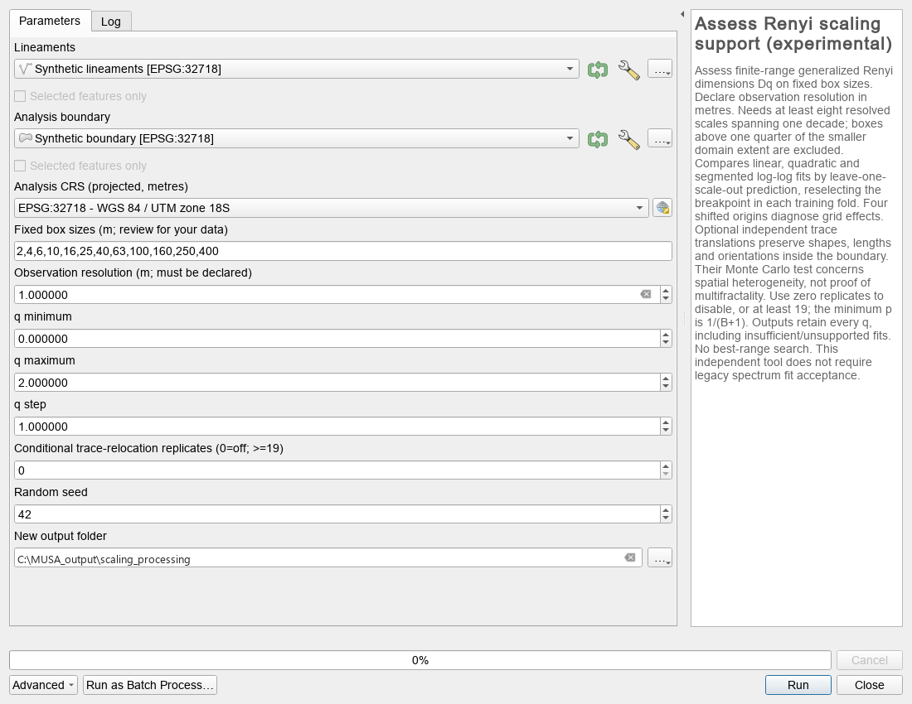
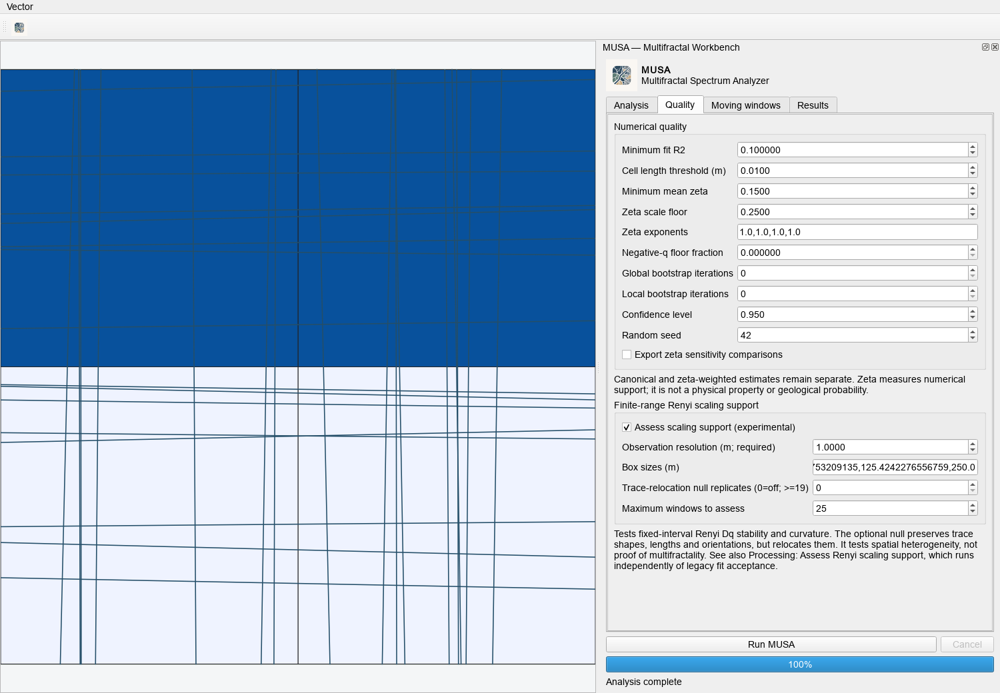
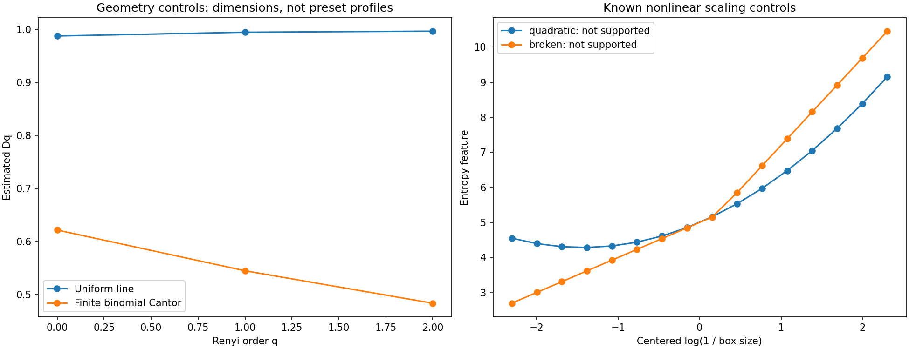

# Finite-range Rényi scaling support

Feature of MUSA 1.1.0; still marked experimental in the interface. Dq denotes
generalized Rényi dimensions: D0 capacity, D1 information and D2 correlation.
They are different orders of one planar length measure, not added spatial axes.

## Use in QGIS

Processing > MUSA > Assess Renyi scaling support runs independently of the
legacy analysis R2 gate, so unsuitable input can still receive a diagnostic.
Choose lines, a polygon and a projected analysis CRS in metres. Declare the
observation resolution from the mapping source, not an arbitrary pixel size.
The example box sizes are editable examples, not recommended geological scales.
Output must be a new folder. Both memory and selected inputs use the normal
QGIS snapshot and reprojection adapter.

Alternatively, in Workbench > Quality, enable Assess scaling support. This adds
reports to the shared analysis and saved recipes. Leave Box sizes blank to use
the analysis scales; the original defaults often provide too few scales for
this diagnostic, intentionally yielding insufficient information. Supply more
distinct, justified box sizes when observations support them.

When Moving windows and this assessment are both enabled, the workflow assesses
the global domain and every computed window. Empty box-size input uses each
window's internal divisors. If the number of windows exceeds the explicit limit
(default 25), the run fails and retains partial outputs; it does not select a
favorable subset. Reduce the number of windows or deliberately increase the
budget. Null simulation cost multiplies with windows, scales and replicates.

## Fixed design and numerical decisions

No favorable interval or q is selected after seeing the fit. All requested q,
rejections and exclusions remain in the reports. No zeta weights or negative-q
probability floor are applied here. Coincident trace segments must first be
deduplicated; this assessment rejects them rather than silently altering the
shape inventory underlying the null hypothesis.

Defaults, all recorded in JSON:

- Exclude boxes smaller than the declared observation resolution, or larger than
  one quarter of the smaller bounding-box dimension of the actual support.
- Require at least 8 remaining box sizes spanning at least 1 order of magnitude,
  80% of a nominal window's area and at least 2 effective boxes at every scale
  and every tested origin for that q.
- Fit Rényi entropy Hq against log(1 / box size), averaging entropy over four
  fixed shifted grids. Dq is the linear slope. H1 uses the Shannon limit.
- Require R2 at least 0.98; dimension variation under leave-one-scale-out and
  end trimming, and across origins, must each be at most 0.10. A slope outside
  the planar interval [0,2] beyond this tolerance is flagged, never clipped.
- Compare linear, quadratic and continuous segmented models by leave-one-scale-
  out prediction. The segmented breakpoint is searched anew within each training
  fold, with at least three points per side. The held-out entropy is never used
  to choose that breakpoint.
- Flag an alternative when its cross-validation RMSE is below 0.75 times the
  linear RMSE and the gain divided by log-scale span exceeds 0.03.

These are explicit operational defaults, not universally calibrated geological
thresholds. Cross-validation measures prediction over these scales; it is not
a significance test assuming independent scale observations. Shifted grids and
overlapping windows are dependent. The output also checks the expected
nonincreasing order of Dq, allowing the same finite-range tolerance.

Statuses per support and q:

| Status | Meaning |
| --- | --- |
| compatible_finite_range | Passed the declared numerical criteria on this fixed interval |
| not_supported | Sufficient observations for the diagnostic, but fit, stability or shape criteria failed |
| insufficient_information | Resolution, span, scale count, coverage or effective boxes were inadequate |

None means mathematically proven fractal, proven nonfractal at all scales, or
validated geological interpretation. Finite line segments have asymptotic
dimension 1; this tool addresses their organization over observable scales.

## Conditional spatial null

Set replicates to zero to disable, or at least 19 to enable. A fresh seed makes
the simulation reproducible. Replicates independently translate each supplied,
clipped trace part uniformly over feasible placements in the polygon. Shapes,
lengths, orientations, trace count and total mass are retained. Intersections,
local density and spatial dependencies are intentionally changed. The model is
conditional on the observed shapes; it is not appropriate for every geological
sampling design. Boundary censoring and interpretation of original fault IDs
are not reconstructed. Exact coincident segments are not allowed in input.

The statistic is the fixed D0 minus D2 contrast; both q=0 and q=2 must be present
and have compatible finite-range scaling. The same scales, grid offsets and
estimator are used for every realization. No simulated realization is discarded
until its fit passes. A failed placement or insufficient simulated support
prevents a p-value rather than triggering selective resampling. A degenerate
null distribution also receives no p-value.

The upper-tail Monte Carlo value is (1 + number of simulated contrasts at least
as large as observed) / (B + 1), including ties. It tests placement-related
heterogeneity under this specific null, not the hypothesis that the network is
multifractal. The minimum raw p is 1/(B+1).

Holm adjustment covers every requested support in the final report, including
untestable supports conservatively counted as p=1. One contrast is tested per
support, not independently for every q row. CSV repeats the same support p beside
each q for convenience. Holm allows dependence; it does not correct subsequent
manual searches across other runs, scale designs or null models. A report with
m supports requires at least m/(B+1) <= 0.05 even to resolve a first Holm rejection
at 0.05; JSON flags inadequate Monte Carlo resolution.

## Outputs and reproduction

scaling_support.json records scales, exclusions, full entropy curves at each
origin, model coefficients, nested predictive errors, stability diagnostics,
null realizations, assumptions, seed and adjusted values. scaling_support.csv
is the compact support/q table. The workbench loads that table into the run's
QGIS layer group and summarizes the counts by status. Window center_id,
center_x, center_y and window_m allow joining to existing window products.

The diagnostic also records direct tau, alpha and f(alpha) feature fits on the
same probabilities/scales/origins. Tau(1)=0 remains an identity, and Dq-only
bounds are not applied to the other quantities. See [SPECTRA.md](SPECTRA.md)
for the indexed viewer, three distinct peak references and identity checks.

The independent Processing tool reserves a new folder and writes a manifest
with source snapshot hashes, recipe, completion/failure status and output hashes.
The shared workflow does the same. Failed or cancelled runs retain partial files;
their incomplete support family must not be interpreted as a completed map.
Cancellation is cooperative between input features, scales and null placements.
Polygon intersection/union itself can still take time.

With the project development launcher:

~~~text
python -m pytest -q
python scripts/validate_scaling_support.py --output NEW_EXTERNAL_DIRECTORY --trials 24 --replicates 39
~~~

The validation script creates actual line geometries, known-dimension and
binomial Cantor controls, independent curved/broken-scale curves and repeated
datasets generated under the conditional null. It does not use the legacy
illustrative synthetic-profile table.

The first pilot tested 24 null-generated datasets with 39 simulations each:
1 of 24 rejected at 0.05. All 24 were testable. The binomial 95% interval for the
rejection probability was approximately 0.0011–0.2112, too wide to certify a 5%
error rate. This is a reproducible pilot for one shape inventory and one domain,
not general calibration, power validation or independent peer review.

## References

- [Rényi (1961), On Measures of Entropy and Information](https://digicoll.lib.berkeley.edu/record/112906).
- [Chhabra and Jensen (1989), direct singularity spectrum](https://journals.aps.org/prl/abstract/10.1103/PhysRevLett.62.1327).
- [Gonzato and colleagues (1998), practical scaling pitfalls](https://academic.oup.com/gji/article/132/2/275/671597).
- [Phipson and Smyth (2010), finite Monte Carlo p-values](https://gksmyth.github.io/pubs/PermPValuesPreprint.pdf).
