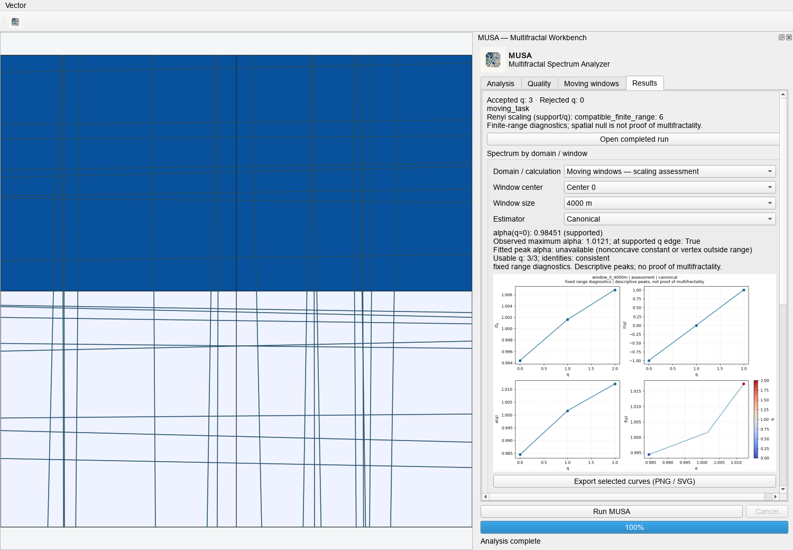

# Dq, tau and singularity spectra by window

Experimental local QGIS 1.0.0. Results now provides a spectrum selector for the
global domain or each moving-window center and size. Choose the calculation
source and available estimator. Results separates Spectra, Figures and Run details.
The Chart selector offers one readable chart or a four-chart overview, rendered
directly on a resizing Qt canvas. Click a spectrum to open an enlarged view with
zoom, pan and export controls; click a Figures preview for a zoomable original.
Export the selected chart as PNG/SVG. No image is automatically generated for every window.
Use Open completed run to inspect a saved workflow or independent Processing
run without rerunning the analysis or adding duplicate map layers. Failed or
cancelled manifests are refused; older completed runs still expose their files.

## Calculation sources and quality

Analysis uses the original global/window calculation and its fit/box gates.
Windows offer canonical and zeta-weighted estimates; the global analysis is
canonical. A weighted global spectrum is not invented by averaging windows.

Scaling assessment uses its declared observation resolution, fixed interval,
four shifted grids and stability/model checks. It is canonical only. Its
probabilities, interval and origins can differ from the normal analysis; the
viewer labels these sources separately instead of attaching one source's
quality flag to another source's estimate.

All requested q remain in the data store. Missing estimates remain missing;
unsupported computed points are grey. Connections follow q order and break
at rejected q, so alpha sorting cannot disguise a turn or bridge missing support.

The per-q table retains estimates, status and failure reasons. Individual Dq,
tau and alpha panels use their own assessment status; a supported Dq does not
make the full singularity spectrum supported. Full-spectrum q counts and peak
summaries still require all four quantities and consistent identities.

On changing calculation source, the center selector initially chooses the center
with the most usable full-spectrum q across its available sizes/estimators. All
centers remain selectable. Scaling-assessment windows display observed coverage
and the required minimum. If coverage is too low, the chart explains that no
estimates exist. For example, 66.7% coverage is insufficient under an 80% minimum;
this is an observation-support limitation, not a zero dimension or a rendering error.

## Computation and identities

Window CSV/GeoPackage rows add tau and tau_w to the existing Dq, alpha, f(alpha)
and weighted results. Tau=(q-1)Dq. Tau(1)=0 is a normalization identity, with
no invented fit R2 and no independent claim of scaling.

The scaling assessment obtains Renyi entropy, the log partition sum and both
direct Chhabra-Jensen features from the same box probabilities at each scale
and origin. It does not differentiate a smoothed tau curve. All regressions use
log(1/epsilon), with the appropriate sign for the partition/CJ features.
The linear/quadratic/segmented and scale/grid diagnostics extend to tau, alpha
and f(alpha). The planar Dq bound is not applied to the other quantities:
negative tau below q=1 is normal, and alpha can exceed the embedding dimension.

Numerical checks, with absolute tolerance 1e-7, retain discrepancies without
clipping or replacing values:

- tau(q)=(q-1)Dq;
- f(alpha(q))=q alpha(q)-tau(q);
- f(alpha(0))=D0 when q=0 is evaluated;
- f(alpha(1))=alpha(1) and tau(1)=0 when q=1 is evaluated.

These identities are not independent significance tests. The optional spatial
null remains the predeclared D0-D2 contrast with the existing Holm correction.
No extra p-values for these correlated quantities have been introduced.

## Three separate singularity references

1. alpha_q0 is alpha at evaluated and supported q=0. There is no interpolation
   or nearest-q substitution if q=0 is absent or rejected.
2. The observed peak is the maximum f(alpha) among usable q. Ties preserve all
   corresponding q/alpha values instead of choosing an arbitrary winner. The
   summary retains a single alpha if every maximizing q has exactly that alpha.
   Otherwise all tied alpha values remain listed. A separate flag
   identifies a maximum at an edge of the supported q set.
3. The fitted peak is the vertex of a descriptive quadratic. It requires at
   least three distinct alpha values, a nondegenerate full-rank fit, concavity,
   finite R2 and a vertex inside the observed alpha interval. Exactly three
   usable q are labeled interpolation_only, never statistical validation.

Usable summary points have accepted source support, four finite estimates and
consistent identities. Missing/invalid peaks stay empty with a reason. The
width delta_alpha is the observed range over usable points, not extrapolation
to unknown extreme q. A quadratic peak is not a probability-histogram mode.

## Outputs and public readers

- Existing analysis_report.csv and spectrum_fit_summary.csv remain available.
  Existing window columns remain; tau and tau_w are added.
- spectrum_summary.csv has one row per source, support and estimator, including
  all three references, ties, width, q counts and fit/identity status.
- spectrum_curves.sqlite is indexed by series and q. The QGIS selector reads
  metadata first and fetches only the chosen spectrum's points.
- The moving GeoPackage includes window_spectrum_summary as a registered
  nonspatial attributes table. Join with source, center_id, window_m, estimator.
- scaling_support.json retains per-quantity fits and per-origin features;
  its CSV adds tau/alpha/f statuses and identity diagnostics.

Python readers: list_spectra(path), read_spectrum(path, series_id), and
spectrum_figure(spectrum). They need no QGIS. SQLite readers are read-only;
standalone Agg figures do not switch the host Matplotlib backend. Normal and
recipe-based workflows produce these products without new recipe requirements.

The cache is staged before replacement; cancellation retains its previous
complete version. Failed/cancelled runs keep partial artifacts and are not
loaded as completed spectra. Older runs without this cache remain accessible
as their existing files, without automatic modification or migration.

These finite-range estimates and descriptive peaks do not certify fractality,
geological connectivity, permeability or prospectivity.
