# Manual de usuario de MUSA para QGIS

Versión experimental 1.0.0 · QGIS comprobado: 3.44.12 · 2 de noviembre de 2026.

Este manual acompaña una revisión práctica de la interfaz y una ejecución real con fracturas publicadas de Åland. Las capturas muestran el complemento funcionando en el runtime de QGIS; no son diseños simulados. El ejemplo sirve para aprender el flujo y reconocer sus límites, no como demostración de multifractalidad de todas las redes naturales.

## 1. Qué necesitas y cómo instalar

Necesitas QGIS y el ZIP de MUSA. En QGIS, abre Plugins > Manage and Install Plugins > Install from ZIP y selecciona el ZIP del complemento. Comprueba que MUSA esté habilitado. Abre Vector > MUSA > MUSA Workbench.

El complemento utiliza NumPy, SciPy, Shapely y Matplotlib del Python de QGIS. Si aparece un módulo ausente, debe instalarse mediante el entorno o gestor de la distribución de QGIS; instalarlo en otro Python no cambia el de QGIS. MUSA no instala dependencias automáticamente.

La versión comprobada es QGIS 3.44.12. El rango declarado 3.34–3.99 no significa que se hayan probado todas sus versiones. La publicación de este nuevo paquete en el catálogo oficial y su publicación en PyPI son procesos distintos de instalar el ZIP.

## 2. Preparar las capas

MUSA necesita una capa de líneas y un polígono que describa dónde se observaron. El polígono debe representar el área realmente examinada; un rectángulo arbitrario puede cambiar los resultados. Revisa geometrías, duplicados y resolución cartográfica antes de interpretar un espectro.

El ejemplo contiene 610 segmentos de una red de fracturas publicada y su dominio. Los segmentos provienen de recorte y unión geométrica; no equivalen necesariamente a 610 fracturas originales independientes. El CRS EPSG:3067 corresponde a Finlandia. Para datos propios, elige una proyección métrica adecuada a su ubicación.

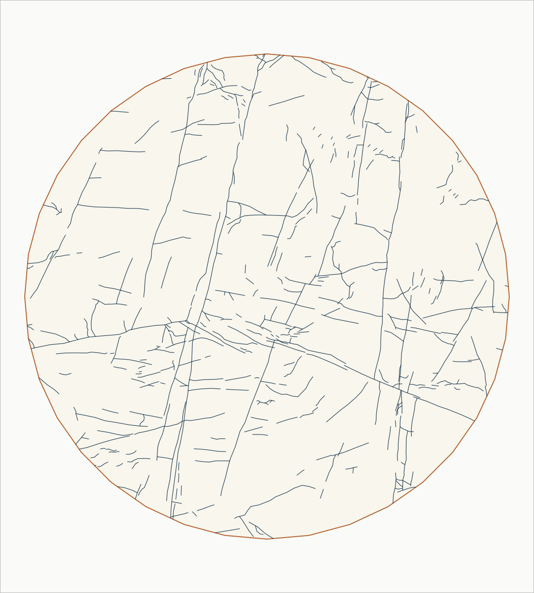

En la entrega del manual, abre example/MUSA_Aland.qgz. También puedes arrastrar example/Aland_fractures_and_domain.gpkg a QGIS y cargar sus capas lineaments y boundary. Los datos no se incluyen en el código del plugin.

## 3. Configurar Analysis

En Lineaments selecciona la capa de líneas. En Boundary selecciona el dominio. Analysis CRS debe usar metros. La casilla Use selected lines only limita las líneas a la selección actual; el límite sigue utilizando todas las entidades del polígono.

Mother cell define el tamaño de las celdas madre. Internal divisors determina los tamaños de las cajas: tamaño de caja = Mother cell / divisor. No deben elegirse escalas más finas que lo que permiten los datos. Cambiar estos parámetros cambia la pregunta espacial del análisis.

Para reproducir la configuración del ejemplo, utiliza Mother cell = 20 m; divisores 4,6,8,12,16,24,32,48,64; q de −4 a 4 con paso 1; y threshold = 0 m en Quality. Activa los productos locales, estructurales, figuras y GeoPackage. La conectividad completa puede dejarse desactivada para esta primera prueba.

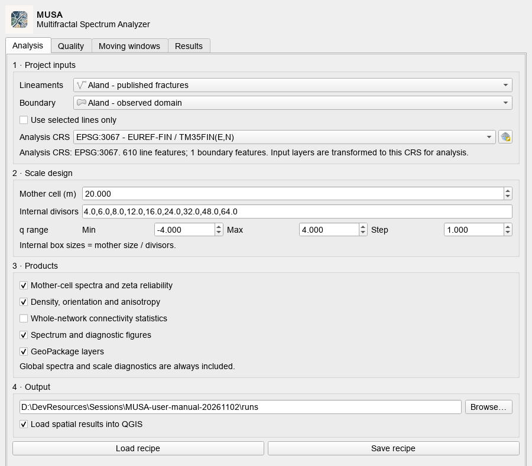

En Output elige una carpeta padre existente mediante Browse. Cada ejecución crea una subcarpeta nueva. Load spatial results into QGIS carga los resultados al terminar. Save recipe guarda los parámetros; Load recipe permite recuperarlos. La receta no incorpora las capas de entrada.

## 4. Configurar Quality y el diagnóstico de escalamiento

El ajuste descriptivo usa Min R² = 0,9 en este ejemplo. Superar ese filtro permite conservar una estimación, pero no prueba multifractalidad. El bootstrap está desactivado en esta demostración; activarlo aumenta el trabajo y no corrige problemas del muestreo original.

Zeta resume apoyo numérico mediante factores de ocupación, conservación de masa, escala y equilibrio. Mantén los espectros canónico y ponderado separados. Zeta no es permeabilidad ni probabilidad de validez geológica.

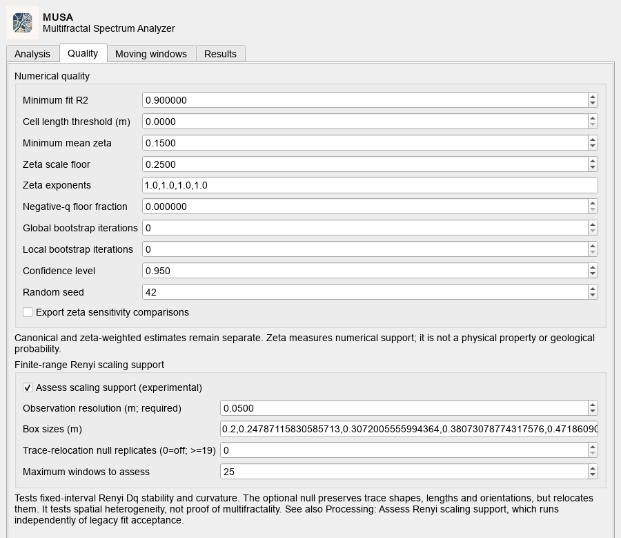

Para el diagnóstico independiente, activa Assess scaling support. La resolución operacional de este ejemplo es 0,05 m: es una hipótesis de trabajo declarada, no una precisión cartográfica medida. Se usan 16 escalas geométricas entre 0,2 y 5 m. La receta incluida conserva sus valores completos.

El diagnóstico necesita suficientes escalas resueltas; cuatro divisores del análisis descriptivo no bastan para sustituir su mínimo de ocho escalas. Examina ajuste, estabilidad de escala y cuadrícula, y modelos alternativos. Cada observable puede recibir un estado distinto.

Trace-relocation null replicates = 0 significa que el contraste nulo está desactivado en este ejemplo. Si se solicita, el contraste evalúa una hipótesis espacial concreta; su valor p no es una certificación universal de multifractalidad.

## 5. Configurar Moving windows

Activa Enable moving-window analysis. En el ejemplo se usa una ventana de 10 m, centros separados 5 m y divisores internos 2,4,8,16. Las ventanas vecinas se solapan y sus resultados son dependientes.

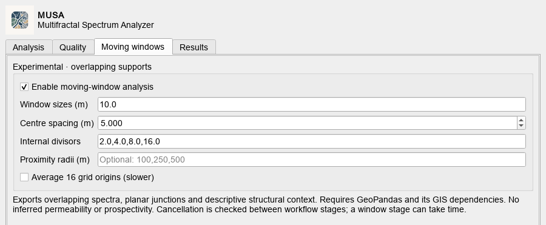

La configuración normal usa un origen; el ensamble de 16 orígenes es opcional y aumenta el trabajo. No convierte automáticamente sus divisores en otro diseño de escalas. Los cruces y nodos son relaciones geométricas planares; no prueban conexión hidráulica tridimensional.

## 6. Ejecutar y comprobar que terminó

Pulsa Run MUSA. La barra indica progreso y Cancel solicita la cancelación. Algunas etapas comprueban la solicitud entre operaciones, por lo que la respuesta puede tardar. Una ejecución fallida o cancelada puede conservar archivos parciales: no debe leerse como un análisis completo.

Al terminar, comprueba Analysis complete o el estado complete del manifiesto. Complete describe la ejecución del software. La calidad científica de cada soporte y q se revisa por separado.

La ejecución ilustrada produjo cinco q aceptados y cuatro rechazados en el ajuste global descriptivo. El diagnóstico Dq independiente registra 20 pares soporte/q compatibles, 91 insuficientes y seis sin respaldo. Esos números no cuentan ventanas independientes ni espectros completos aprobados.

## 7. Leer Results > Spectra

Domain / calculation distingue análisis global, análisis por ventanas y diagnóstico de escalamiento. Selecciona después centro, tamaño y estimador. El análisis por ventanas ofrece canónico y ponderado por zeta; el diagnóstico independiente es canónico.

El selector abre inicialmente el centro con más q utilizables para el espectro completo entre sus opciones disponibles. Todos los centros siguen accesibles. En este ejemplo elige Center 5, con cobertura de aproximadamente 99,6 %.

Chart permite elegir Dq, tau(q), alpha(q), f(alpha) o la vista de cuatro gráficos. Una curva individual utiliza el estado de su observable; un Dq respaldado puede coexistir con un tau no respaldado y un espectro completo no utilizable.

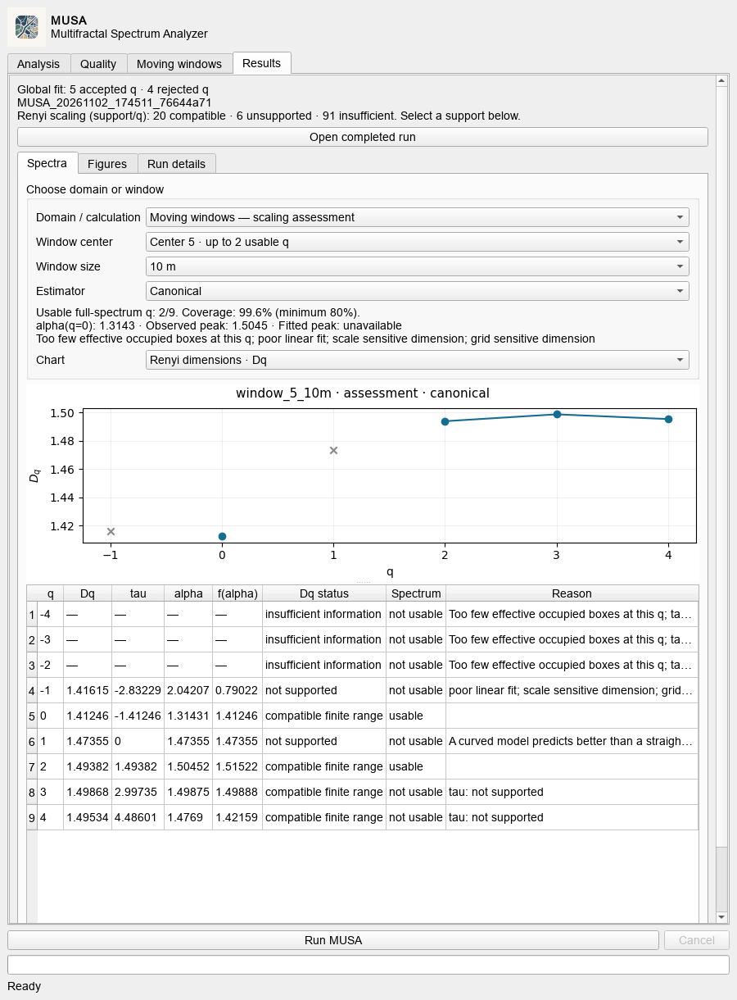

Los valores calculados sin respaldo aparecen en gris. Un guion en la tabla significa que no hay estimación; no es cero. La columna Reason explica el estado. Puedes desplazar la tabla para revisar todos los q y sus columnas.

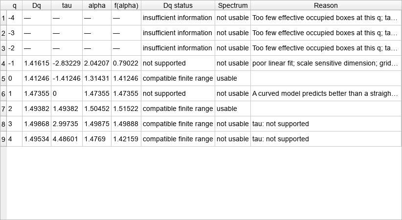

En Center 5 solo q = 0 y q = 2 cumplen los requisitos conjuntos del espectro completo en esta ejecución. Por eso se muestran 2/9 utilizables y no se obtiene un pico cuadrático ajustado. Con dos q no se debe presentar un espectro bien caracterizado ni concluir multifractalidad robusta.

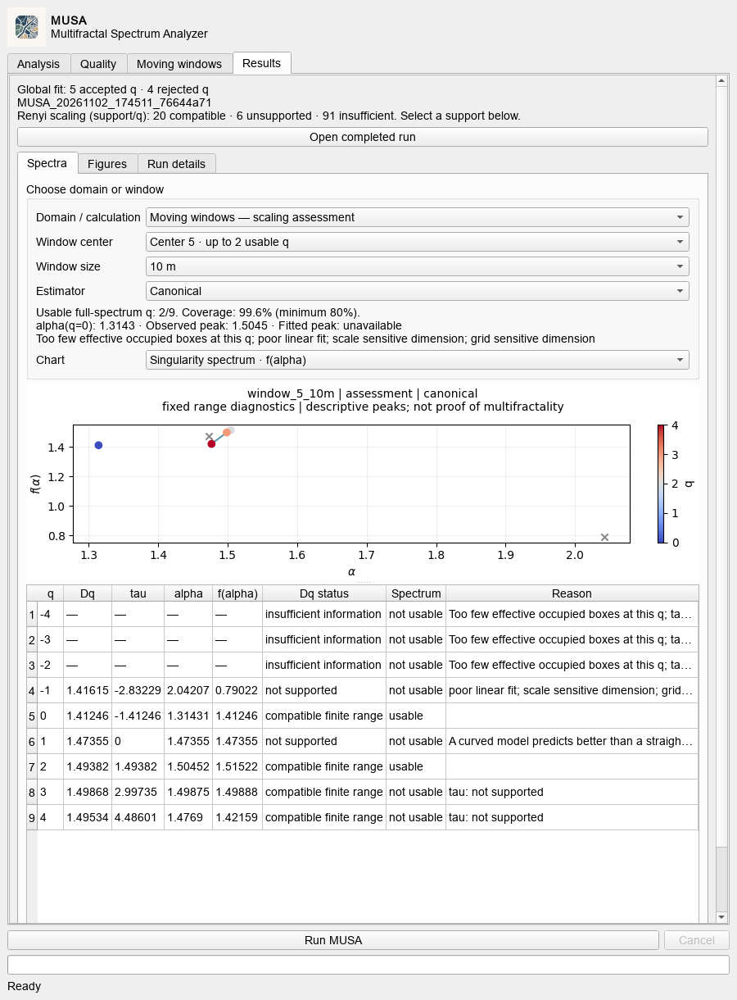

alpha(q=0), el máximo observado de f(alpha) y el pico de un ajuste cuadrático son referencias distintas. Fitted peak requiere al menos tres valores adecuados de alpha y otros controles; con exactamente tres sigue siendo una interpolación descriptiva. Unavailable es un resultado válido cuando esos requisitos no se cumplen.

## 8. Entender una ventana sin valores

Selecciona Center 1. Solo aproximadamente el 66,7 % de su superficie cae dentro del dominio observado; el mínimo del diagnóstico es 80 %. Por eso todos sus q se conservan como información insuficiente, con motivo de baja cobertura, y no se calculan dimensiones para ese soporte.

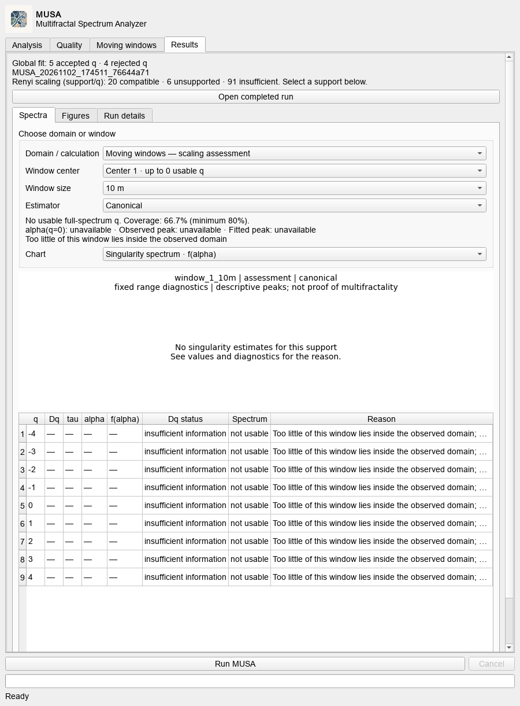

Eso no significa que la red tenga dimensión cero, ni que el motor se haya detenido. Otros centros del mismo análisis pueden tener cobertura suficiente. No bajes el umbral después de ver el resultado solo para obtener una curva; revisa el dominio y el diseño de ventanas con una justificación previa.

Los estados se leen así: compatible finite range significa compatibilidad en el intervalo probado; not supported indica que los criterios no respaldan ese modelo; insufficient information indica que faltan condiciones para estimarlo. Que D0 sea compatible no valida por sí solo Dq para todos los q ni toda la forma del espectro.

## 9. Ampliar y exportar gráficos

Haz clic sobre un espectro para abrir una ventana ampliada. Utiliza los controles de zoom, desplazamiento, restablecimiento y guardado de su barra. Cerrar esa ventana devuelve al panel y no repite el análisis.

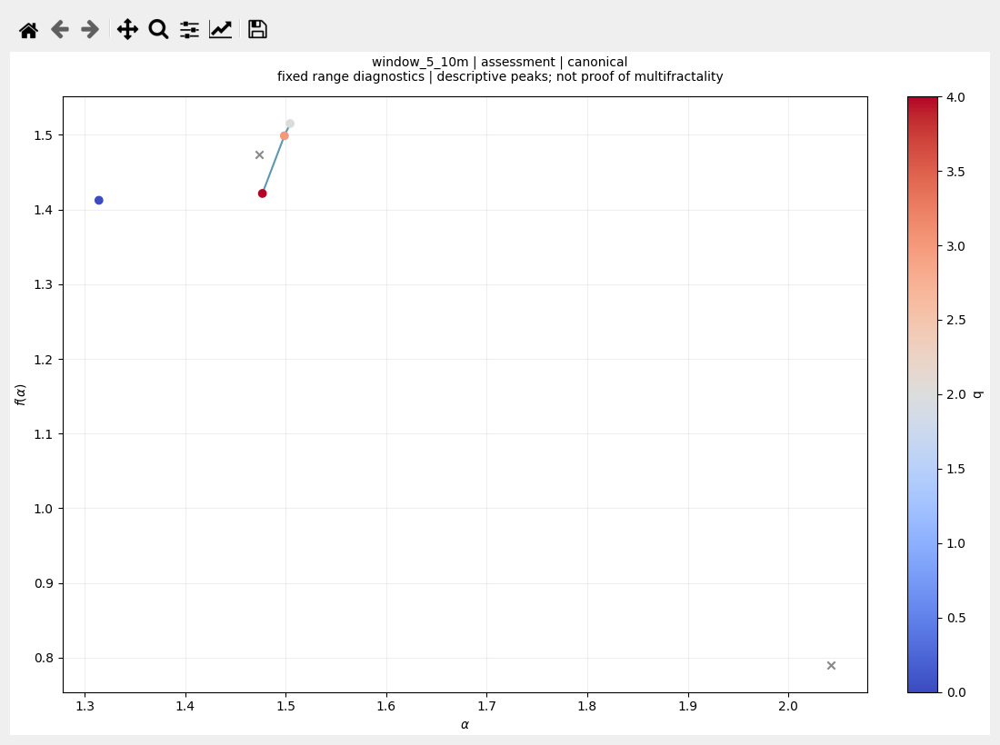

Export selected curves guarda el gráfico seleccionado como PNG o SVG. PNG es práctico para informes; SVG conserva elementos vectoriales. Comprueba el soporte, la fuente y el estimador antes de exportar.

Results > Figures permite revisar las figuras generales guardadas por la ejecución. Selecciona una y pulsa sobre su vista previa para ampliarla. La ventana de imágenes ofrece Zoom +, Zoom −, Fit y Actual pixels; puedes arrastrar la imagen para recorrerla.

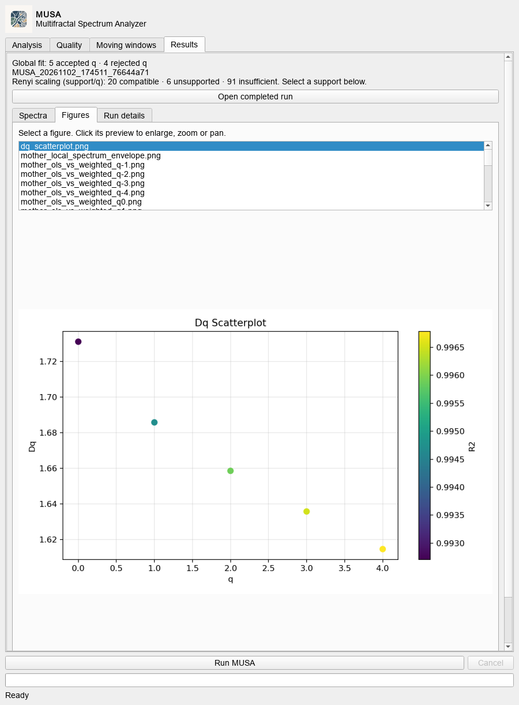

Una figura rasterizada antigua no gana resolución al ampliarla. Para las curvas seleccionables, usa la vista nativa y la exportación SVG cuando necesites texto y trazos nítidos.

## 10. Scroll, detalles y recuperación de una ejecución

Results dispone de scroll vertical cuando el contenido no cabe. La rueda sobre un gráfico o selector desplaza la página; no cambia de centro accidentalmente. La tabla de valores y Run details tienen además su propio desplazamiento para recorrer su contenido.

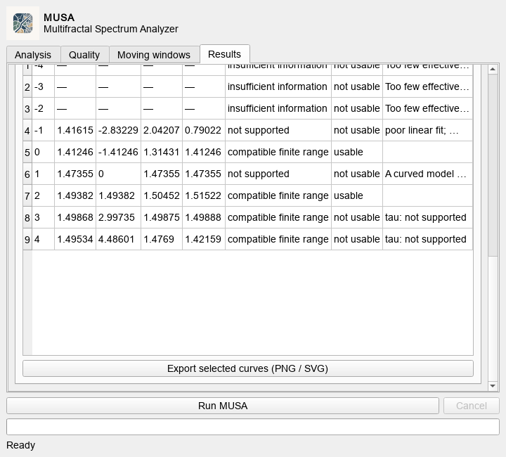

En Run details se muestran estado, versión, fechas UTC, procedencia, configuración y archivos de salida. Al reabrir una ejecución, estos datos se recuperan del manifiesto. Los mensajes de progreso en vivo solo se muestran si pertenecen a la ejecución actual y están disponibles; no se reconstruye un registro histórico inexistente.

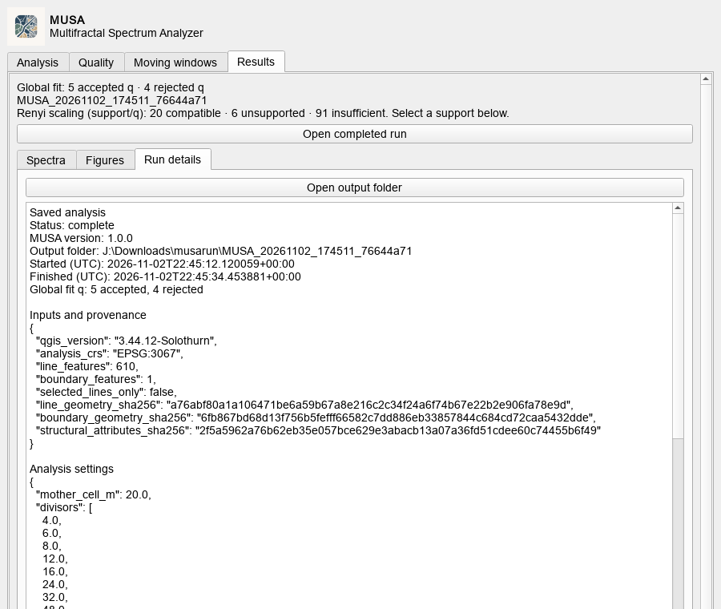

Open output folder abre la carpeta. Open completed run permite inspeccionar otra ejecución terminada sin recalcular ni añadir otra copia de las capas al proyecto. Selecciona la carpeta que contiene run_manifest.json, no un PNG aislado.

## 11. Guardar y compartir

Guarda el proyecto de QGIS y conserva sus capas. La receta guarda parámetros, no las entradas. La carpeta del análisis conserva tablas, figuras, GeoPackages, manifiesto y el índice de espectros; sus productos dependen de las opciones habilitadas.

Para compartir, conserva la estructura completa de carpetas y las entradas necesarias. El workflow no crea un ZIP automáticamente. No confundas el ZIP instalable del plugin con una carpeta de resultados ni con el proyecto QGIS.

En los mapas, los productos por q pueden tener varias filas por ventana y simbología predeterminada para q = 2. Revisa filtros, tamaño de ventana y atributos antes de comparar capas. Intensidad estructural, confiabilidad y espectros son productos distintos.

## 12. Problemas frecuentes y lista final

- No aparece MUSA: revisa que el complemento esté habilitado y abre Vector > MUSA > MUSA Workbench.
- No permite iniciar: comprueba capa de líneas, dominio, CRS métrico, valores de configuración y carpeta padre existente.
- Error de CRS: asignar una etiqueta EPSG no reproyecta coordenadas erróneas; verifica primero el CRS de origen.
- No quedan dos q aceptados: revisa escalas, resolución, geometría y datos; no reduzcas el filtro de calidad automáticamente.
- Ventana vacía: revisa cobertura, presencia de líneas y resolución en Reason. Elige otro soporte para comparar.
- Pico ajustado ausente: comprueba el número de q utilizables y las condiciones del ajuste; no extrapoles un máximo.
- Detalles o tabla largos: usa su barra interior. Si el panel completo no cabe, usa el scroll exterior de Results.
- Figura pequeña: pulsa sobre ella para ampliarla; utiliza SVG para exportar las curvas seleccionables.

Antes de interpretar, confirma unidades y dominio; documenta resolución y escalas; verifica los q utilizables; conserva rechazos y valores ausentes; distingue canónico, zeta y diagnóstico independiente; guarda entradas, receta y resultados. El software no deduce permeabilidad, favorabilidad ni conectividad 3D.

## Alcance de las comprobaciones y referencias

Se comprobaron el desplazamiento con rueda sobre gráficos y selectores, la estabilidad de la selección, el acceso a detalles recuperados, paneles pequeños, ventanas con y sin cobertura, ampliación y cierre de figuras, y exportación SVG. Las pruebas nativas adicionales cubren ejecución en segundo plano, Processing, reproyección y cancelación. Esas comprobaciones de software no sustituyen validación científica externa.

Datos de ejemplo: redes de fracturas de Åland, Ovaskainen y colaboradores; [dataset de autores](https://doi.org/10.5281/zenodo.7919843) y [artículo](https://doi.org/10.5194/se-14-603-2023). La preparación y sus límites están en la documentación de benchmarks de MUSA. La resolución operacional de 0,05 m no debe citarse como precisión medida por los autores.

El motor también puede utilizarse sin QGIS mediante la API Python. La instalación, arquitectura y teoría completas están en [documentación de MUSA](https://github.com/jordan-zav/MUSA/blob/main/docs/README.md). La publicación en PyPI y una CLI general permanecen pendientes en esta entrega.
