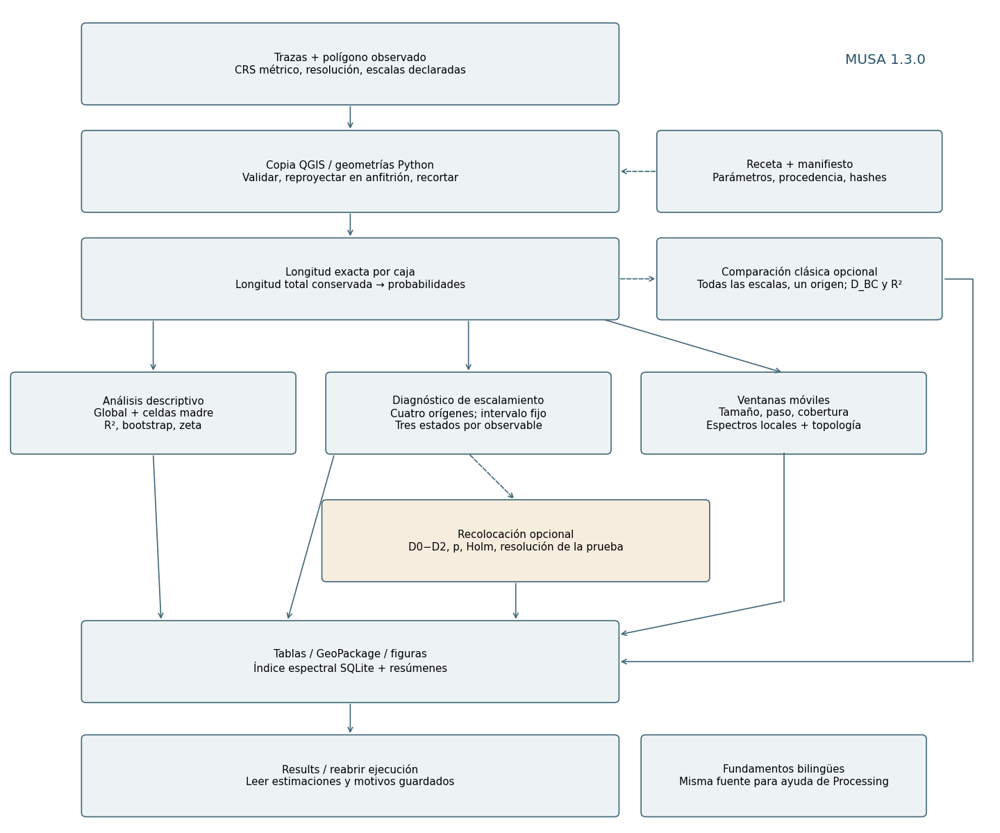

# Mapa del flujo y referencia de controles

[English](WORKFLOW.md) · [Español](WORKFLOW.es.md)

Cada fila relaciona un control visible con su adaptador y función del núcleo. Los productos dependen de las opciones activadas; el inventario efectivo está en run_manifest.json. Las rutas sin prefijo pertenecen a src/musa; workbench.py y provider.py pertenecen a qgis_plugin. Los nombres de controles permanecen en inglés para localizarlos en la interfaz.

[SVG](images/workflow.es.svg)

El diagrama y esta tabla se regeneran con python scripts/build_workflow_map.py. Las flechas discontinuas representan configuración o una etapa opcional.

| Pestaña / control o algoritmo | Adaptador → núcleo | Producto o efecto | Fundamentos / guía |
| --- | --- | --- | --- |
| Analysis: Lineaments, Boundary, Use selected lines only, Analysis CRS | qgis_plugin/inputs.py: snapshot_sources, make_analyzer → MUSA.from_line_geometries | run_manifest.json: source; WKB in memory | [KB §7](KNOWLEDGE_BASE.es.md); [Guide §2](USER_GUIDE.es.md) |
| Analysis: Mother cell, Internal divisors | core.py: resolutions_from_mother_cell → run_analysis | analysis_report.csv; analysis_scale_diagnostics.csv | [KB §5](KNOWLEDGE_BASE.es.md); [Guide §3](USER_GUIDE.es.md) |
| Analysis: q Min, Max, Step | workflow.py: RunConfig → core.py: run_analysis; scaling.py | analysis_report.csv; scaling_support.csv; spectrum_curves.sqlite | [KB §7](KNOWLEDGE_BASE.es.md); [Guide §3](USER_GUIDE.es.md) |
| Analysis: Mother-cell spectra and reliability | core.py: export_cell_outputs | monofractal_cells.csv; multifractal_cells.csv; multifractal_mother_agg.csv | [KB §7](KNOWLEDGE_BASE.es.md); [Guide §3](USER_GUIDE.es.md) |
| Analysis: Density, orientation and anisotropy | structural.py: compute_lineament_mother_structural_stats | lineament_mother_structural_stats.csv | [KB §8](KNOWLEDGE_BASE.es.md); [Guide §6](USER_GUIDE.es.md) |
| Analysis: Whole-network connectivity statistics | network.py: compute_lineament_network_stats | lineament_network_stats.csv | [KB §8](KNOWLEDGE_BASE.es.md); [Guide §6](USER_GUIDE.es.md) |
| Analysis: Spectrum and diagnostic figures | plotting.py: export_analysis_plots, export_mother_plots | dq_scatterplot.png; r2_fit_quality.png; multifractal_singularity_spectrum*.png | [KB §8](KNOWLEDGE_BASE.es.md); [Guide §8](USER_GUIDE.es.md) |
| Analysis: GeoPackage layers | qgis_plugin/native_gis.py: export_mother_layers; moving.py: export_moving_windows | musa_mother_cells.gpkg; musa_moving_windows.gpkg | [KB §8](KNOWLEDGE_BASE.es.md); [Guide §9](USER_GUIDE.es.md) |
| Analysis: Output, Browse, Load spatial results into QGIS | workflow.py: execute_analysis; workbench.py: load_spatial_results | new run folder; QGIS layers | [KB §8](KNOWLEDGE_BASE.es.md); [Guide §3](USER_GUIDE.es.md) |
| Analysis: Save recipe, Load recipe | workflow.py: RunConfig.recipe, from_recipe; workbench.py: apply_config | recipe.json (parameters) | [KB §8](KNOWLEDGE_BASE.es.md); [Guide §3](USER_GUIDE.es.md) |
| Quality: Minimum fit R2, Cell length threshold | core.py: run_analysis, _probabilities_for_scale | analysis_report.csv; optional mother-cell tables | [KB §7](KNOWLEDGE_BASE.es.md); [Guide §3](USER_GUIDE.es.md) |
| Quality: Minimum mean zeta, Zeta scale floor, Zeta exponents | core.py: _zeta_mother_scale, _is_reliable, export_cell_outputs | multifractal_mother_agg.csv: canonical and weighted fields | [KB §8](KNOWLEDGE_BASE.es.md); [Guide §3](USER_GUIDE.es.md) |
| Quality: Negative-q floor fraction | core.py: _stabilize_probs_for_q | analysis_report.csv; recipe.json | [KB §7](KNOWLEDGE_BASE.es.md); [Guide §3](USER_GUIDE.es.md) |
| Quality: Global/Local bootstrap iterations, Confidence level, Random seed | core.py: _bootstrap_global_confidence_intervals, _bootstrap_regression_ci | confidence columns in analysis_report.csv / mother tables | [KB §8](KNOWLEDGE_BASE.es.md); [Guide §3](USER_GUIDE.es.md) |
| Quality: Export zeta sensitivity comparisons | core.py: export_zeta_sensitivity_summary | zeta_sensitivity_summary.csv | [KB §8](KNOWLEDGE_BASE.es.md); [Guide §3](USER_GUIDE.es.md) |
| Quality: Assess scaling support, Observation resolution, Box sizes | scaling.py: assess_lineament_scaling, assess_curve | scaling_support.json; scaling_support.csv | [KB §7](KNOWLEDGE_BASE.es.md); [Guide §4](USER_GUIDE.es.md) |
| Quality: Maximum windows to assess | workflow.py: execute_analysis window assessment loop | scaling_support.json: requested supports and states | [KB §7](KNOWLEDGE_BASE.es.md); [Guide §6](USER_GUIDE.es.md) |
| Quality: Renyi order policy, Coarse-end trimming | scaling.py: _pair_order, _trim_coarse, assess_lineament_scaling | scaling_support.json: order diagnostics, scale_trimming | [KB §7](KNOWLEDGE_BASE.es.md); [Guide §4](USER_GUIDE.es.md) |
| Quality: Classic box counting (comparison only) | classic.py: classic_box_counting, write_classic_comparison | classic_comparison.json; classic_box_counting.csv | [KB §6](KNOWLEDGE_BASE.es.md); [Guide §8](USER_GUIDE.es.md) |
| Quality: Run trace-relocation Monte Carlo test, Relocation replicates, Test tail | scaling.py: _relocate, monte_carlo_two_sided, monte_carlo_tail, holm_adjust | scaling_support.json: null; scaling_support.csv: p and Holm | [KB §7](KNOWLEDGE_BASE.es.md); [Guide §5](USER_GUIDE.es.md) |
| Moving windows: Enable, Window sizes, Centre spacing, Internal divisors | moving.py: analyze_moving_windows, export_moving_windows | moving_windows.csv; moving_nodes.csv; moving_windows_config.json | [KB §8](KNOWLEDGE_BASE.es.md); [Guide §6](USER_GUIDE.es.md) |
| Moving windows: Average 16 grid origins | moving.py: ENSEMBLE_OFFSETS, analyze_moving_windows | moving_windows.csv; moving_windows_config.json | [KB §8](KNOWLEDGE_BASE.es.md); [Guide §6](USER_GUIDE.es.md) |
| Moving windows: Proximity radii | proximity.py: analyze_fault_proximity; candidates.py: evaluate_candidates | potential_relations.csv; candidate_evidence.csv; trap_candidates.csv | [KB §8](KNOWLEDGE_BASE.es.md); [Guide §6](USER_GUIDE.es.md) |
| Run MUSA, Cancel, progress and status | workbench.py: AnalysisTask → workflow.py: execute_analysis; control.py: check_cancelled | run_manifest.json: complete/failed/cancelled; partial files retained | [KB §8](KNOWLEDGE_BASE.es.md); [Guide §7](USER_GUIDE.es.md) |
| Results: classic comparison and Monte Carlo summary | learning.py: comparison_text, relocation_text; workbench.py: set_run_summary | reads classic_comparison.json and scaling_support.json | [KB §8](KNOWLEDGE_BASE.es.md); [Guide §8](USER_GUIDE.es.md) |
| Results: Domain/calculation, Window center, Window size, Estimator | spectrum_products.py: list_spectra, read_spectrum | reads spectrum_curves.sqlite; spectrum_summary.csv | [KB §8](KNOWLEDGE_BASE.es.md); [Guide §8](USER_GUIDE.es.md) |
| Results: Chart, per-q table, Reason | spectrum_products.py: spectrum_figure, spectrum_shape_reasons; workbench.py: render_selected_spectrum | q-indexed curves and joint-spectrum gates; in-memory view | [KB §7](KNOWLEDGE_BASE.es.md); [Guide §8](USER_GUIDE.es.md) |
| Results: click spectrum, Export selected curves | qgis_plugin/chart_view.py: ChartView.open_enlarged; spectrum_products.py: spectrum_figure | selected PNG or SVG | [KB §8](KNOWLEDGE_BASE.es.md); [Guide §8](USER_GUIDE.es.md) |
| Results: Figures, click preview, Zoom/Fit/Actual pixels | qgis_plugin/chart_view.py: ImagePreview | reads saved PNG; in-memory enlarged view | [KB §8](KNOWLEDGE_BASE.es.md); [Guide §8](USER_GUIDE.es.md) |
| Results: Run details, Open completed run, Open output folder | workbench.py: show_run_details, open_completed_run, open_output | reads run_manifest.json and saved spectral index; no recalculation | [KB §8](KNOWLEDGE_BASE.es.md); [Guide §8](USER_GUIDE.es.md) |
| Learn / Fundamentos: language, chapter, links | qgis_plugin/learning.py: source_path, learning_html; workbench.py: LearningBrowser | docs/KNOWLEDGE_BASE*.md → packaged Markdown and HTML, 13 figures per language | [KB §1–8](KNOWLEDGE_BASE.es.md); [Guide §11](USER_GUIDE.es.md) |
| Processing: musa:analyze (LINES, BOUNDARY, CRS, MOTHER, DIVISORS, RESOLUTION, q, R2, products, CLASSIC_COMPARISON, OUTPUT) | provider.py: AnalyzeAlgorithm → workflow.py: execute_analysis | same global, optional mother/structural, assessment and classic files; run_manifest.json | [KB §8](KNOWLEDGE_BASE.es.md); [Guide §3](USER_GUIDE.es.md) |
| Processing: musa:scaling_support (inputs, SCALES, RESOLUTION, q, NULL_REPLICATES, RENYI_ORDER_POLICY, NULL_TAIL, COARSE_TRIM, SEED, CLASSIC_COMPARISON, OUTPUT) | provider.py: ScalingSupportAlgorithm → scaling.py: assess_lineament_scaling, write_scaling_reports | scaling_support.json/CSV; spectrum_curves.sqlite; classic files if requested; run_manifest.json | [KB §7](KNOWLEDGE_BASE.es.md); [Guide §4](USER_GUIDE.es.md) |
| Processing: musa:run_recipe (LINES, BOUNDARY, CRS, RECIPE, OUTPUT) | provider.py: AnalyzeAlgorithm(recipe=True) → RunConfig.from_recipe → execute_analysis | all enabled recipe products; recipe.json; run_manifest.json | [KB §8](KNOWLEDGE_BASE.es.md); [Guide §3](USER_GUIDE.es.md) |
| Processing: Help / local knowledge link | provider.py: helpUrl → learning.py: help_url | packaged KNOWLEDGE_BASE*.html; same canonical chapter | [KB §1–8](KNOWLEDGE_BASE.es.md); [Guide §11](USER_GUIDE.es.md) |

## Lectura del flujo

El flujo descriptivo siempre calcula el ajuste global y exige al menos dos q aceptados. El diagnóstico independiente conserva sus tres estados y puede ejecutarse mediante musa:scaling_support sin ese filtro global. La comparación clásica usa todas las escalas y un origen; la longitud exacta alimenta ambos cálculos. La prueba espacial utiliza únicamente el intervalo retenido antes de simular. Las ventanas tienen cobertura y estados propios. Reabrir una ejecución lee sus archivos.

La disponibilidad de estimaciones por q y la aceptación de la forma conjunta f(alpha) se evalúan por separado. Las vistas indican por qué se retiene una curva. Los cuadernos de [API Python](../notebooks/README.md) recorren esos contratos sin QGIS.
